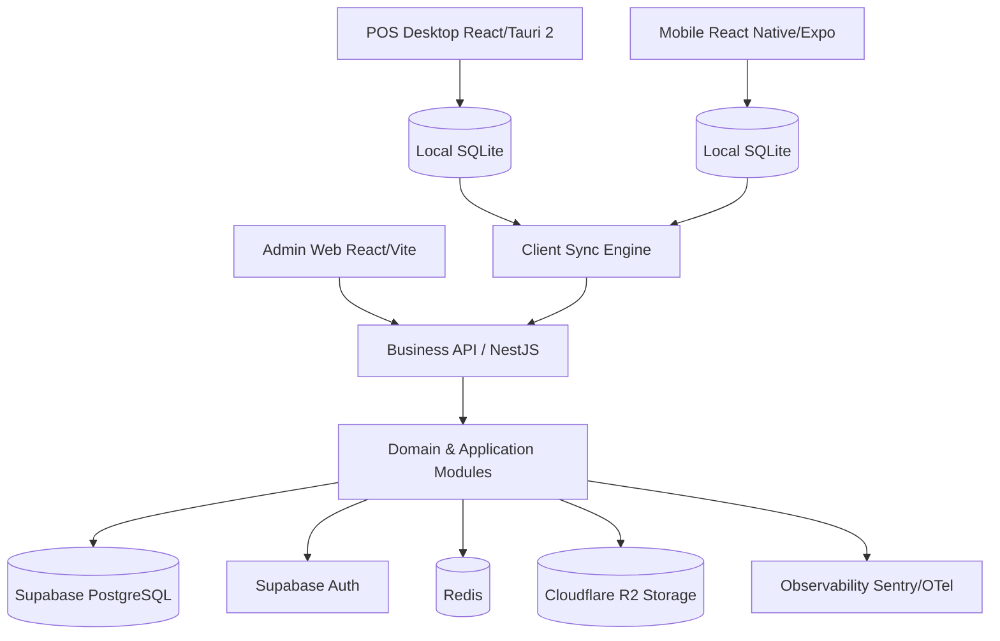

# Architecture

## 1. Architectural Decision & Core Identity

**STOKROVA** is a **modular monolith** backend built with **NestJS**, backed by **Supabase PostgreSQL & Supabase Auth**, with **local-first clients** (Tauri 2 desktop, Expo mobile, React web) and **Cloudflare R2** object storage.

The platform is a **World-Class Inventory, Commerce & Business Operations Platform** managing the complete physical-goods lifecycle:
$$\text{Procurement} \longrightarrow \text{Receiving} \longrightarrow \text{Storage} \longrightarrow \text{Inventory} \longrightarrow \text{Sales} \longrightarrow \text{Fulfillment} \longrightarrow \text{Payments} \longrightarrow \text{Transfers} \longrightarrow \text{Returns} \longrightarrow \text{Finance}$$

The platform is designed around **progressive complexity**: it serves a single-trader shop with zero bureaucratic friction, yet scales dynamically to high-traffic wholesale distribution and multi-branch enterprises through a **graph-based workflow engine** and **scoped dynamic RBAC**.

```text
Mobile / POS / Admin Web
       │
       ▼
   NestJS API (Authoritative Business Brain)
       │
 ┌─────┴───────────────────────┐
 │                             │
Supabase Auth            Supabase PostgreSQL
(JWT / Identity)       (Relational State + RLS Defense)
```

Direct client-to-database CRUD is strictly forbidden. The NestJS application layer enforces all business rules, domain invariants, and authorization.

---

## 2. High-Level Topology



---

## 3. Server Module Boundaries (12 Capability Domains)

```text
server/
  modules/
    identity/          # Supabase Auth integration, user sessions, credentials
    tenancy/           # Tenants, companies, legal entities, branches
    authorization/     # Scoped dynamic RBAC, custom tenant roles, permissions
    catalog/           # Products, variants, SKUs, units, barcodes, categories, brands
    pricing/           # Price lists, wholesale tiers, branch pricing, promotions
    inventory/         # 8-tier locations, stock balances, lot/batch/serials, reservations
    stock_movements/   # Append-only immutable inventory ledger (13 movement types)
    work_centers/      # Work stations (Sales, Picking, Packing, Cashier, Dispatch)
    registers/         # Registers/tills, cash sessions, float & blind variance
    workflows/         # Graph-based DAG workflow engine, task queues, concurrency leases
    rules/             # Declarative business rules & approval policies
    sales/             # Orders, invoices, quotations, retail POS carts, wholesale orders
    customers/         # Customer profiles, credit limits, account balances, history
    procurement/       # Suppliers, RFQs, purchase orders, receiving & inspection
    payments/          # Payments (Cash, Bank Transfer, Card), refunds, allocations
    finance/           # Chart of accounts, general journal, double-entry ledger, expenses
    fulfillment/       # Picking, packing, verification, dispatch, transit tracking
    manufacturing/     # Bills of materials (BOM), work orders, assembly/disassembly
    intelligence/      # ADS forecasting, reorder points, replenishment recommendations
    synchronization/   # Idempotent inbox, client outbox, monotonic change feed
    documents/         # Invoice, receipt, PO, and delivery note document generator
    notifications/     # In-app, email, SMS, and webhook alerts
    search/            # High-performance search across catalog, orders, and serials
    files/             # Cloudflare R2 object storage provider abstraction
    audit/             # Immutable audit events & security incident monitoring
```

---

## 4. Deep Inventory & 8-Tier Physical Location Model

1. **8-Tier Location Topology**:
   ```text
   Tenant -> Company -> Branch -> Warehouse -> Zone -> Aisle -> Rack -> Shelf -> Bin
   ```
2. **Multi-State Stock Availability**:
   - **Physical On-Hand Partition**: $\text{Physical On-Hand} = \text{Physically Unrestricted} + \text{Quarantined} + \text{Damaged} + \text{Physically Restricted}$
   - **Commitments Decoupling**: Reservations and Allocations are logical claims against sound stock, not separate physical piles.
   - **Available-to-Promise (ATP)**: $\text{ATP} = \text{Physically Unrestricted} - (\text{Allocated} + \text{Reserved})$
3. **Traceability, Lots & Serials**:
   - **Lot/Batch Tracking**: Batch number, manufacture date, expiry date, FEFO picking logic.
   - **Serial Number Tracking**: Unique discrete unit lifecycle from supplier intake to customer sale.
4. **Immutable Movement Ledger**:
   $$\text{Current Stock} = \sum(\text{valid inventory ledger movements})$$
   Direct mutation of stock quantities (`UPDATE products SET stock = ...`) is prohibited across all endpoints and jobs.

---

## 5. Operations: Configurable Workflows as a Subsystem

The workflow engine is an **operations subsystem**, not the entire application:
- It orchestrates *what happens next* and *who should perform it* across Commerce, Inventory, Procurement, and Logistics.
- Operates via a Directed Workflow Graph with validated transitions, controlled loops, retries, and bounded execution (Sequential, Branching, Parallel, Merging, Approval, Rework Loops).
- Published workflow versions are strictly immutable.
- High-throughput queues with lease-based concurrency locking prevent race conditions between workers.
- Workflows orchestrate domain services, but **never bypass domain invariants**.

---

## 6. Financial Truth, Cash Sessions & Accounting

1. **Cash Truth & Registers**:
   - Registers/tills operate through explicit `RegisterSession` lifecycles.
   - Opening float $\rightarrow$ Real-time cash movements $\rightarrow$ Blind closing count $\rightarrow$ Computed variance.
2. **Separation of Financial Concerns**:
   $$\text{Order} \neq \text{Invoice} \neq \text{Payment} \neq \text{Receipt}$$
   - Invoices establish legal receivables.
   - Payments capture funds with strict idempotency keys (`operation_id`).
   - Receipts are customer documentation; reprinting a receipt never duplicates a financial payment.
3. **Double-Entry General Ledger**:
   - Chart of Accounts with append-only journal entries ($\sum \text{debits} = \sum \text{credits}$).
   - Corrections require explicit reversing entries; history is never deleted.

---

## 7. Scoped Dynamic RBAC

Authorization decouples identity from rigid application roles:

```text
Identity (Supabase Auth)
  -> Membership (Tenant / Company)
    -> Role Assignment
        ├── Role (System Template or Custom Tenant Role)
        ├── Permissions (Granular capability codes)
        └── Scope (Tenant, Company, Branch, Warehouse, Register, Work Center)
```

Platform Super Admins (SaaS operations) are strictly separated from Tenant Business Owners. A user can hold multiple roles across different locations (e.g. Manager in Branch Lagos, Cashier on Register 02).

---

## 8. Progressive Complexity Model

The platform adapts to the business, rather than forcing the business to adapt to the software:

- **Level 1 (Solo / Micro-Trader)**: Single unified screen (Sell, Products, Stock, Cash, Reports). Complex stages collapse into an instant background transaction pipeline.
- **Level 2 (Structured Retail)**: Sales Desk $\rightarrow$ Cashier.
- **Level 3 (Wholesale / Distribution)**: Sales Desk $\rightarrow$ Picking Queue $\rightarrow$ Verification $\rightarrow$ Packing $\rightarrow$ Cashier $\rightarrow$ Dispatch.
- **Level 4 (Multi-Branch Enterprise)**: Multi-branch transfers, approval matrices, and distributed work centers.

The underlying transaction, ledger, and accounting engine is identical across all levels.

---

## 9. IDs, Timestamps, Money, and Invariants

- **IDs**: UUIDv7 / ULID generated client-side for offline-capable entities.
- **Timestamps**: UTC in storage (`created_at`, `occurred_at`, `server_received_at`).
- **Money**: Integer minor units (`amount_minor bigint`) + currency code. Never floating-point.
- **Auditing**: Append-only audit events with sensitive field sanitization.

---

## 10. Offline & Synchronization Pipeline

- Local SQLite on desktop (Tauri 2) and mobile (Expo).
- Atomic local commit: `business local state change` + `outbox record`.
- Server inbox: `sync_operations` with idempotency by `operation_id`.
- Ordered change log: `sync_changes` with monotonic sequence cursors.
- Conflict policy: append-only for stock ledger and payments; domain exception workflows for master data collisions (zero naive last-write-wins).

---

## 11. Object Storage, Integrations & Observability

- **Storage**: Primary Cloudflare R2 (S3-compatible SDK via `StorageProvider` abstraction) for product images, documents, and exports.
- **Peripherals**: ESC/POS thermal printers, barcode/QR scanners, cash drawers, scales.
- **Observability**: Structured logs, OpenTelemetry traces, Sentry error capture, correlation IDs across all commands.
