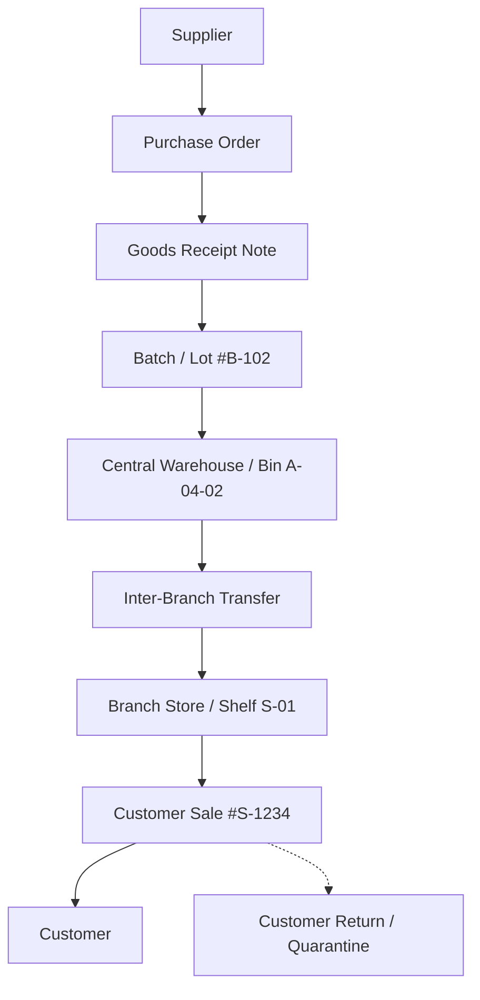

# Domain Model

## 1. Core Bounded Contexts (The 12 Capability Domains)

### 1. Identity & Tenancy
Responsible for:
- tenants (isolated client tenants)
- companies / legal entities
- branches (geographic operating units)
- users & credentials (via Supabase Auth)
- memberships & user-to-tenant mappings
- devices (registered desktop, mobile, POS hardware)
- sessions & refresh tokens

### 2. Authorization & Governance
Responsible for:
- capability permissions (granular action codes)
- role templates (Business Owner, Branch Manager, Sales Clerk, Picker, Checker, Cashier, etc.)
- custom tenant-defined roles
- multi-dimensional permission scoping (Tenant $\rightarrow$ Company $\rightarrow$ Branch $\rightarrow$ Warehouse $\rightarrow$ Register $\rightarrow$ Work Center)
- separation of SaaS Super Admin from Tenant Business Owner

### 3. Catalog & Product Master
Responsible for:
- product concepts
- sellable variants
- SKUs & universal identifiers
- 1D barcodes & 2D QR codes
- product categories & brands
- units of measure (UOM)
- auditable unit conversions (e.g. 1 carton = 24 pieces)
- packaging specifications, bundles, and kits
- product media (Cloudflare R2 images)

### 4. Deep Inventory Core
Responsible for:
- 8-tier physical location hierarchy (Tenant $\rightarrow$ Company $\rightarrow$ Branch $\rightarrow$ Warehouse $\rightarrow$ Zone $\rightarrow$ Aisle $\rightarrow$ Rack $\rightarrow$ Shelf $\rightarrow$ Bin)
- multi-state stock quantities (On-hand, Available, Reserved, Allocated, Quarantined, Damaged, Incoming, Outgoing, Safety Stock)
- lots and batches (batch numbers, manufacture dates, expiry dates, FEFO/FIFO policies)
- serial numbers (discrete per-unit lifecycle, condition, warranty)
- stock allocations against sales orders
- stock counts & blind physical audits
- inventory adjustments with mandatory reason codes

### 5. Stock Movement Ledger
Responsible for:
- immutable movement ledger entries (`inventory_movements`)
- 13 standard movement types (Opening Balance, Purchase Receipt, Sale Issue, Customer Return, Supplier Return, Transfer Out, Transfer In, Damage, Expiry, Adjustment, Count Correction, Reservation, Release Reservation)
- derived materialized balances (`inventory_balances`)
- full physical genealogy and traceability from intake to disposal

### 6. Operations & Workflows
Responsible for:
- Directed Acyclic Graph (DAG) workflow definitions
- versioning & publication immutability
- work centers / stations (Sales Desk, Picking, Packing, Verification, Cashier, Dispatch)
- task generation from business events
- high-throughput task queues with concurrency leases
- declarative rule evaluation & manager approval requests

### 7. Commerce & Sales
Responsible for:
- multi-channel sales (Retail POS, B2B Wholesale, Quotations, Sales Orders)
- cart calculations with configurable tax & rounding
- dynamic price lists (Retail, Wholesale, Distributor)
- customer group pricing & branch-specific price overrides
- volume/tiered price breaks & promotional bundles
- sales invoices & delivery slips
- returns, credit notes, and voiding policies

### 8. Procurement & Supplier Management
Responsible for:
- supplier directory & profiles
- material / stock purchase requisitions
- requests for quotation (RFQ) & quotation comparisons
- purchase orders (PO)
- goods receipt notes (GRN) & inbound inspection
- landed costs & supplier invoices (3-way matching: PO, GRN, Invoice)
- supplier performance analytics (lead times, defect rates)

### 9. Customers & Credit
Responsible for:
- customer master records & contacts (Retail vs B2B Entities)
- billing & shipping addresses
- credit terms (e.g. Net 30) & credit limits
- customer ledger accounts & statements
- customer loyalty programs

### 10. Finance, Cash Truth & Accounting
Responsible for:
- registers/tills & register sessions
- opening float records & cash movements (Cash In, Cash Out, Cash Sale, Cash Refund)
- blind closing cash count & automated variance computation
- payment captures (Cash, Bank Transfer, Card) with strict idempotency keys (`operation_id`)
- customer receipts & immutable print tracking
- double-entry chart of accounts & general journal entries ($\sum \text{debits} = \sum \text{credits}$)
- expense tracking & accounts payable/receivable reconciliation

### 11. Logistics & Fulfillment
Responsible for:
- pick list generation & zone/bin routing
- packing verification & carton labeling
- dispatch & manifest creation
- inter-branch and inter-warehouse transfers with in-transit tracking
- delivery dispatch, driver routing, and proof of delivery

### 12. Intelligence & Analytics
Responsible for:
- average daily sales (ADS) calculation
- reorder point (ROP) & safety stock modeling
- automated replenishment recommendations
- dead stock and slow-moving inventory alerts
- batch expiry warning pipelines
- gross margin and inventory turnover analytics

---

## 2. Key Business Invariants

### Inventory Invariants

1. **Immutable Movement Truth**: Current inventory balance is strictly the sum of all valid posted movements:
   $$\text{Current Stock} = \sum(\text{Posted Inventory Movements})$$
   No database record or API endpoint may execute direct balance updates (`UPDATE products SET stock = ...`).
2. **Non-Negative Stock**: Negative stock is strictly disallowed by default. Only explicit tenant-level policy can permit temporary controlled negative stock.
3. **Mandatory Movement Justification**: Every inventory movement must reference a valid business transaction (PO, Sale, Transfer, Count, Adjustment) and a reason code.
4. **Permanent History**: Posted inventory movements can never be deleted or modified. Corrections require explicit adjustment or reversing movement entries.
5. **Transfers Paired and Balanced**: A stock transfer between locations creates a paired `TRANSFER_OUT` and `TRANSFER_IN` movement. In-transit stock resides in a designated transit virtual location.
6. **Unique Serial Integrity**: A serialized unit can exist in exactly one location and state at any point in time. It cannot be sold, transferred, or received twice concurrently.
7. **Expiry & FEFO Discipline**: Batches subject to expiry policies enforce First Expired, First Out (FEFO) picking unless overridden by authorized exception.
8. **Audited Stock Counts**: Physical stock count variances generate an auditable `STOCK_COUNT_ADJUSTMENT` movement; they never erase prior transaction logs.

### Sales & Pricing Invariants

1. **Determined Price Resolution**: Applied pricing resolves deterministically and stores historical unit prices on transaction lines:
   $$\text{Base Price} \longrightarrow \text{Price List} \longrightarrow \text{Branch Override} \longrightarrow \text{Customer Tier} \longrightarrow \text{Promotion} \longrightarrow \text{Authorized Discount}$$
   Subsequent catalog price changes never mutate historical sales lines.
2. **Separation of Document Concerns**:
   $$\text{Sales Order} \neq \text{Invoice} \neq \text{Payment} \neq \text{Receipt}$$
3. **Receipt Reprint Safety**: Printing or reprinting a receipt never creates a financial payment or mutates account balances.
4. **Idempotent Write Commands**: Replaying an offline or online command with the same `operation_id` guarantees exactly-once execution.

### Financial Invariants

1. **Double-Entry Balance**: Every posted journal entry must satisfy:
   $$\sum \text{Debits} = \sum \text{Credits}$$
2. **Immutable Journals**: Posted journal entries cannot be edited or deleted. Corrections must be made through reversing journal entries.
3. **Register Cash Truth**: Register sessions enforce blind closing counts. The system computes expected cash from transaction history and records variance without disclosing expected figures to the cashier prior to count submission.

---

## 3. Physical Goods Lifecycle & Traceability

The platform guarantees full end-to-end traceability across every physical item:

At any point in time, the system can instantly answer:
- **Where did this specific item/batch come from?**
- **Where is it currently located?**
- **To which customer/order was it dispatched?**

---

## 4. Multi-State Stock Equations

Physical stock partitions are decoupled from commercial commitments to eliminate double-counting:

$$\text{Physical On-Hand} = \text{Physically Unrestricted} + \text{Quarantined} + \text{Damaged} + \text{Physically Restricted}$$

$$\text{Available to Promise (ATP)} = \text{Physically Unrestricted} - (\text{Allocated} + \text{Reserved})$$

$$\text{Net Salable Stock} = \max(0, \text{ATP} - \text{Safety Stock})$$

$$\text{Projected Stock} = \text{Physical On-Hand} + \text{Incoming (Approved POs \& In-Transit)} - (\text{Allocated} + \text{Reserved})$$

---

## 5. Demand Forecasting & Replenishment Model

For inventory intelligence and automated reordering:

1. **Average Daily Sales (ADS)**:
   $$\text{ADS} = \frac{\sum \text{Sales Quantities over } N \text{ days}}{N}$$
2. **Reorder Point (ROP)**:
   $$\text{ROP} = (\text{ADS} \times \text{Supplier Lead Time in Days}) + \text{Safety Stock}$$
3. **Suggested Order Quantity (EOQ / Target Stock)**:
   $$\text{Order Qty} = \text{Target Maximum Stock} - (\text{On-Hand} + \text{Incoming} - \text{Committed})$$
