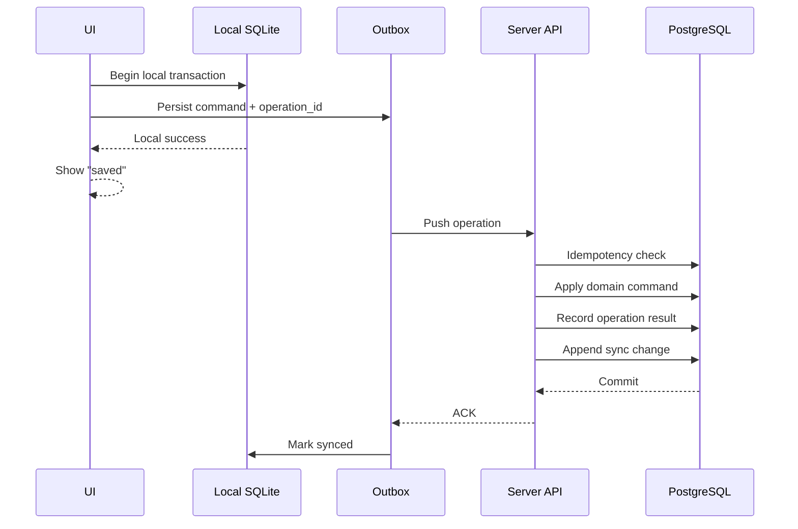

# Offline-First Synchronization Protocol

## 1. Goal

A supported business operation performed offline must be:

- persisted locally before UI success is shown
- uniquely identified
- replayable
- idempotent
- observable
- retryable
- auditable

The client must never "hope" an operation succeeded remotely.

## 2. Core objects

```text
Device
  -> Operation
      -> Command payload
          -> Server transaction
              -> Domain events
                  -> Change log
```

## 3. Client-side flow



## 4. Operation envelope

Recommended structure:

```json
{
  "operation_id": "01...",
  "tenant_id": "01...",
  "device_id": "01...",
  "actor_user_id": "01...",
  "client_sequence": 1842,
  "command_type": "sales.complete",
  "entity_id": "01...",
  "occurred_at": "2026-10-06T14:10:00Z",
  "schema_version": 1,
  "payload": {}
}
```

### Required semantics

`operation_id` is globally unique.

The server must guarantee idempotent handling by `operation_id` within the appropriate tenant/security scope.

## 5. Client outbox

Suggested local table:

```text
outbox_operations
-----------------
operation_id
tenant_id
device_id
actor_user_id
client_sequence
command_type
entity_id
payload_json
schema_version
created_at
attempt_count
next_attempt_at
status
last_error_code
last_error_message
```

Statuses:

```text
PENDING
SENDING
ACKED
FAILED_RETRYABLE
FAILED_PERMANENT
CONFLICT
```

Do not permanently mark an operation failed merely because a request timed out. A timeout may happen after server commit.

Retry after timeout must still be safe because the operation is idempotent.

## 6. Server inbox/idempotency

`sync_operations` acts as the durable inbox.

Before applying a command:

1. verify tenant/device/user authorization
2. check whether `operation_id` was already processed
3. if yes, return the original outcome
4. if not, execute the command transactionally
5. record the result
6. append resulting sync changes
7. commit

The idempotency record and business transaction must be in the same database transaction.

## 7. Pull protocol

Client keeps a cursor:

```text
last_applied_sequence
```

Server endpoint concept:

```text
GET /v1/sync/pull?after=<sequence>&limit=<n>
```

Response:

```json
{
  "from_sequence": 184000,
  "to_sequence": 184250,
  "has_more": true,
  "changes": []
}
```

Client applies changes transactionally, advances the cursor only after successful application.

## 8. Push protocol

Server endpoint concept:

```text
POST /v1/sync/push
```

Payload:

```json
{
  "operations": []
}
```

Response returns per-operation results:

```json
{
  "results": [
    {
      "operation_id": "01...",
      "status": "APPLIED",
      "server_sequence": 184251
    }
  ]
}
```

Possible statuses:

```text
APPLIED
ALREADY_APPLIED
REJECTED
CONFLICT
RETRY
```

## 9. Push/pull order

Do not require a single global order for all devices.

Use:

- per-device client sequence for diagnostics/order
- server sequence for durable change feed ordering
- domain-specific validation for business correctness

The server is authoritative for committed history.

## 10. Conflict model

Do not use global last-write-wins.

### Append-only business actions

Examples:

- sale completed
- payment recorded
- stock movement

Treat as commands/events, not conflicting mutable records.

### Mutable master data

Examples:

- product name
- category description

May use revision/version conflict detection.

### High-risk business state

Examples:

- financial settings
- approved price changes
- stock adjustment approval

May require explicit conflict or server policy.

## 11. Stock conflict example

Two offline devices have the same initial balance:

```text
A sees 50
B sees 50

A sells 10
B sells 15
```

Both sales are valid if stock policy allows the resulting movement.

Do not resolve by overwriting `stock = 35`.

Instead, server applies both immutable issues:

```text
-10
-15
```

and balance becomes:

```text
25
```

If the resulting balance violates a tenant's no-negative-stock policy, the server must reject or route the later operation to a defined conflict/exception workflow.

The policy must be explicit.

## 12. Tombstones

For deletable synchronized master data, do not immediately erase the information needed by other clients.

Use tombstones:

```text
entity_id
entity_type
deleted_at
deleted_by
```

A client that has not synced must learn that the entity was deleted.

## 13. Schema versioning

Every sync operation has:

```text
schema_version
```

The server must support a migration path for supported clients.

Clients that are too old to safely participate may be blocked from writes while still allowed to update/download.

## 14. Retry strategy

Use exponential backoff with jitter.

Do not retry forever at the same interval.

After repeated failure:

- classify error
- keep operation durable
- surface status
- allow manual retry
- preserve diagnostics

## 15. Network states

At minimum:

```text
ONLINE
DEGRADED
OFFLINE
SYNCING
AUTH_REQUIRED
CONFLICT
```

Do not rely only on browser `navigator.onLine` or a network icon. Actual API connectivity must influence sync state.

## 16. Local transaction rule

For a supported offline operation:

```text
business local state change
+
outbox record
```

must be committed atomically in the local SQLite transaction.

If either cannot be committed, the UI must not report success.

## 17. Crash recovery

On app restart:

1. recover database
2. inspect `SENDING` records
3. treat uncertain submissions as retryable
4. preserve operation IDs
5. sync
6. reconcile acknowledgements

Never generate a second operation ID just because the first request timed out.

## 18. Reconciliation

Provide an internal reconciliation job that can detect:

- orphaned sync operations
- missing acknowledgements
- cursor gaps
- duplicate application attempts
- inventory balance inconsistencies
- ledger-to-balance mismatches

Reconciliation is an operations tool, not a normal user workflow.
