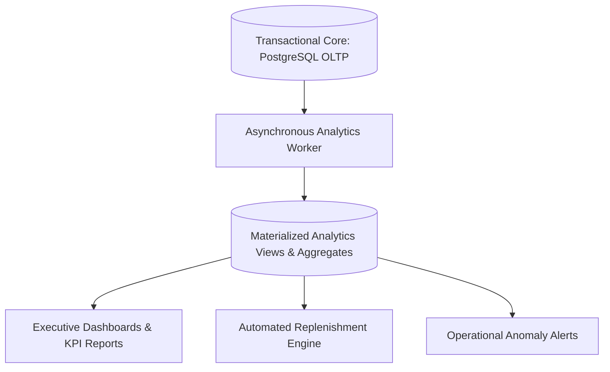

# STOKROVA Master Analytics & Replenishment Intelligence Model

## 1. Analytics Architecture: OLTP vs OLAP Separation

To ensure that high-volume analytical queries never degrade real-time POS checkout or warehouse scanning performance, the analytics domain operates through read-optimized projection models:

---

## 2. Demand Forecasting & Replenishment Intelligence

STOKROVA strictly avoids simplistic `"alert if stock < 10"` logic. Instead, it implements a mathematically sound demand forecasting and replenishment model:

### Formula 1: Average Daily Sales (ADS)
$$\text{ADS} = \frac{\sum_{t=1}^{N} \text{Sales Quantities over } N \text{ days}}{N}$$
- Configurable observation windows: $N = 7$ days (short-term surge), $N = 30$ days (standard trend), $N = 90$ days (seasonal baseline).

### Formula 2: Reorder Point (ROP)
$$\text{ROP} = (\text{ADS} \times \text{Supplier Lead Time in Days}) + \text{Safety Stock}$$
- **Supplier Lead Time**: Dynamically calculated from historical purchase order delivery performance.
- **Safety Stock**: Buffer stock absorbing demand volatility during supplier transit.

### Formula 3: Suggested Order Quantity (EOQ / Target Stock)
$$\text{Suggested Order Qty} = \text{Target Maximum Stock} - (\text{On-Hand} + \text{Incoming POs} - \text{Committed Orders})$$
When current net available stock falls below ROP, the system automatically drafts an inbound Purchase Requisition for the suggested order quantity.

---

## 3. Inventory Health & Risk Analytics

1. **Dead Stock Detection**:
   - Identifies SKUs with zero movements over a configurable inactivity threshold (e.g., $> 90$ days).
   - Computes capital tied up in dormant inventory to guide markdown campaigns.
2. **Batch Expiry Early-Warning Pipeline**:
   - Categorizes perishable batches into risk buckets: Expiring in $< 30$ days (Critical), $< 60$ days (High), $< 90$ days (Moderate).
   - Automatically suggests inter-branch transfers to high-velocity locations or automated price discounts.
3. **ABC Inventory Classification**:
   - **Category A**: Top $20\%$ of items driving $80\%$ of revenue (tight cycle counting).
   - **Category B**: Next $30\%$ of items driving $15\%$ of revenue.
   - **Category C**: Remaining $50\%$ of items driving $5\%$ of revenue.

---

## 4. Cashier & Operational Productivity Metrics

- **Cashier Settlement Variance**: Tracks frequency and magnitude of till cash shortages/overages per cashier over time.
- **Warehouse Fulfillment Speed**: Tracks average pick time, verification scan accuracy, and dispatch latency across teams.
- **Gross Margin by Channel**: Real-time comparison of profit margins across retail POS vs wholesale commercial orders.
