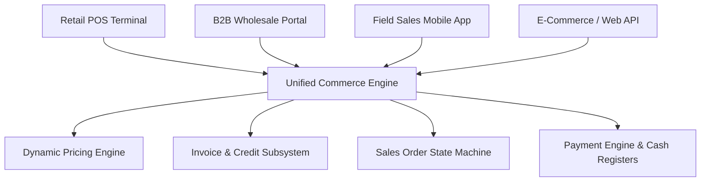
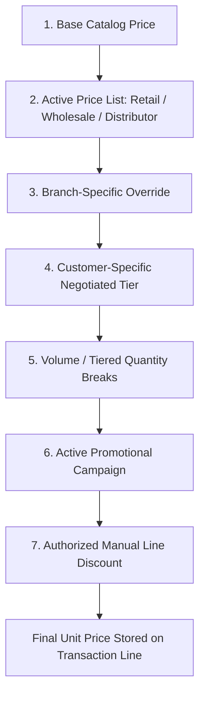

# STOKROVA Master Commerce & Sales Model

## 1. Unified Commerce Architecture

STOKROVA does **not** create separate database models or isolated services for Point of Sale versus Wholesale versus E-commerce.

Instead, a **single unified commerce core** powers all commercial channels:

---

## 2. Dynamic Pricing Engine

Product prices are never hardcoded as a single immutable column. The pricing engine resolves prices deterministically through a cascading resolution hierarchy:

### Deterministic Resolution Algorithm
$$\text{Line Price} = \min(\text{Customer Tier Price}, \text{Volume Tier Price}, \text{Branch Price}) \times (1 - \text{Discount Rate}) + \text{Taxes}$$
- **Historical Immutability**: When a sale is confirmed, the calculated price and applied discount are stamped directly onto the `sales_order_lines` record. Future changes to price lists never alter historical sales data.

---

## 3. High-Speed Point of Sale (POS)

The POS interface is a specialized, high-throughput channel into the commerce engine:

1. **Barcode & Search Speed**:
   - Sub-10ms item resolution via local SQLite cache.
   - Auto-focus input with continuous barcode scanning.
   - Support for 1D barcodes (EAN-13, UPC-A, Code-128) and 2D QR codes.
2. **Cart Management**:
   - Fast cart addition, quantity adjustments, and keyboard hotkeys.
   - Cart suspension (holding carts for customers who forgot an item) and instant resumption.
3. **Split Tender & Payment**:
   - Multi-tender transactions: e.g., ₦20,000 Cash + ₦50,000 POS Card Transfer.
   - Integration with thermal receipt printers (ESC/POS) and RJ11 electronic cash drawers.
4. **Offline Capability**:
   - POS carts commit locally to the client SQLite database and queue to the outbox. Transactions never fail because of internet drops.

---

## 4. Cash Registers & Till Sessions

Cash accountability is enforced via formal `RegisterSession` lifecycles:

1. **Opening Shift**:
   - Cashier records mandatory opening float (e.g. ₦10,000 in change).
2. **Mid-Shift Cash Operations**:
   - Real-time logging of Cash Sales, Cash Refunds, Petty Cash In (`CASH_IN`), and Cash Drop / Safekeeping (`CASH_OUT`).
3. **Blind Closing Count**:
   - Cashier counts and submits the physical cash drawer contents blindly (the system does not display the expected amount beforehand).
4. **Variance Computation**:
   $$\text{Closing Expected} = \text{Opening Float} + \text{Cash Sales} - \text{Cash Refunds} + \text{Cash In} - \text{Cash Out}$$
   $$\text{Variance} = \text{Closing Actual} - \text{Closing Expected}$$
   Variances trigger automatic audit records and notify branch managers if thresholds are exceeded.

---

## 5. B2B Wholesale & Credit Operations

For wholesale and distributor operations:
1. **Credit Limits & Terms**:
   - Pre-configured payment terms (e.g., Immediate, Net 15, Net 30).
   - Automated credit checks prevent order dispatch if outstanding receivables exceed credit limits.
2. **Quotations & Pro-Forma Invoices**:
   - Quotation lifecycle with validity expiry dates.
   - 1-click conversion from Quotation $\rightarrow$ Confirmed Sales Order.
3. **Partial Fulfillment & Backorders**:
   - Orders can be fulfilled across multiple shipments as stock becomes available.
   - Remaining unfulfilled lines generate tracked backorders.
