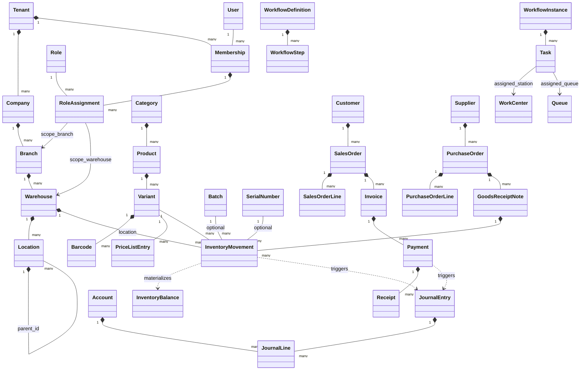

# STOKROVA Master Domain Model & Entity Map

## 1. Executive Domain Architecture

The STOKROVA domain model is structured into bounded contexts that communicate through explicit application service boundaries and strongly-typed contracts, rather than arbitrary database foreign keys or cross-context mutations.

---

## 2. Master Domain Entity Relationship Map

---

## 3. Bounded Context Entity Maps

### Context 1: Tenancy, Organization & Identity
- **Tenant**: Top-level SaaS isolation partition.
- **Company**: Legal entity owning assets, tax registrations, and bank accounts.
- **Branch**: Geographic business facility (e.g. Lagos, Abuja, Kano).
- **Warehouse**: Physical storage building or logistics hub.
- **Location**: Granular physical location (Zone, Aisle, Rack, Shelf, Bin).
- **User**: Authenticated human actor (Supabase Auth identity).
- **Role**: Set of granular capability permissions (`StandardPermissions`).
- **RoleAssignment**: Bridges User, Role, and operational Scope.
- **Device**: Registered hardware terminal (Desktop, POS, Mobile, Scanner).

### Context 2: Catalog & Master Product Data
- **Product**: Abstract commercial concept (e.g., "Men's Polo Shirt").
- **Attribute & AttributeValue**: Dimension definitions (e.g., Size = XL, Color = Navy).
- **Variant**: Specific sellable SKU with barcode, weight, and dimensions.
- **UnitOfMeasure (UOM)**: Base stock unit (e.g., Piece, Carton, Kg, Liter).
- **UnitConversion**: Auditable conversion factor (e.g., 1 Carton = 24 Pieces).
- **PriceList**: Commercial price tier (Retail, Wholesale, Distributor).
- **TaxProfile**: Jurisdictional tax rates (VAT 7.5%, Exempt, Inclusive/Exclusive).

### Context 3: Deep Inventory & Traceability
- **InventoryMovement**: Sole source of inventory truth (append-only ledger).
- **InventoryBalance**: Read-optimized projection of current stock by location.
- **Batch / Lot**: Tracked group of items with manufacture date, expiry date, and supplier trace.
- **SerialNumber**: Discrete physical unit with unique serial string, condition, and warranty status.
- **StockTransfer**: Inter-branch or inter-warehouse transit with paired issue/receipt movements.
- **StockCount**: Blind cycle count with audited variance reconciliation.

### Context 4: Commerce, Sales & POS
- **Customer**: Retail individual or B2B commercial entity with credit terms.
- **Quotation**: Time-limited price offer convertible into a Sales Order.
- **SalesOrder**: Commercial agreement detailing items, quantities, and delivery requirements.
- **SalesOrderLine**: Specific variant line item with locked historical price and applied discount.
- **RegisterSession**: Cashier till shift with opening float, cash transactions, and blind closing count.
- **Invoice**: Legal demand for payment (Accounts Receivable claim).
- **Payment**: Financial transaction capturing cash, card, or bank transfer funds.
- **Receipt**: Customer proof-of-transaction document (reprints never create financial entries).

### Context 5: Procurement & Suppliers
- **Supplier**: Vendor profile, lead times, currency, and payment terms.
- **PurchaseRequisition**: Internal department request for materials.
- **RequestForQuotation (RFQ)**: Solicitation sent to multiple suppliers.
- **SupplierQuote**: Received vendor pricing and delivery estimates.
- **PurchaseOrder**: Legally binding purchase contract.
- **GoodsReceiptNote (GRN)**: Proof of physical stock intake with inspection clearance.
- **SupplierInvoice**: Vendor bill matched against PO and GRN (3-Way Matching).

### Context 6: Operations & Workflows
- **WorkflowDefinition**: Versioned DAG defining steps, transitions, and conditions.
- **WorkflowInstance**: Active execution of a workflow attached to a business transaction.
- **WorkflowStep**: Discrete stage (User Task, Approval, System Action, Gateway).
- **Task**: Action item routed to a user, role, team, or queue.
- **WorkCenter**: Physical operational workstation (Sales, Picking, Checking, Packing, Cashier, Dispatch).
- **Queue**: Shared pool of tasks with lease-based concurrency locks.
- **ApprovalRequest**: Escalation triggered by declarative business rules.

### Context 7: Finance & Accounting
- **Account**: Node in the Chart of Accounts (Assets, Liabilities, Equity, Revenue, COGS, Expenses).
- **JournalEntry**: Balanced double-entry financial record ($\sum \text{Debits} = \sum \text{Credits}$).
- **JournalLine**: Single debit or credit entry on a specific account with currency minor units.
- **FiscalPeriod**: Accounting cycle with open/close locks.
- **Expense**: Discretionary expenditure tracked with receipts and payment allocations.
