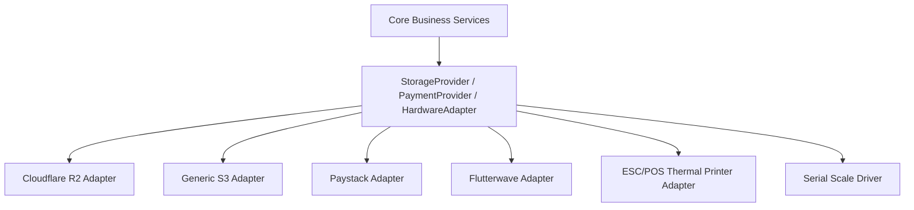

# STOKROVA Master Integration & Peripheral Model

## 1. Integration Architectural Principle: Provider Adapters

External services, third-party platforms, and hardware peripherals are strictly isolated behind **Provider Abstraction Interfaces**. 

The core domain never imports proprietary third-party SDKs directly.



---

## 2. Object Storage Abstraction (`StorageProvider`)

All product images, PDF invoices, and export documents route through a unified interface:

```typescript
export interface StorageProvider {
  uploadFile(params: {
    tenantId: string;
    path: string;
    content: Buffer;
    contentType: string;
    isPublic: boolean;
  }): Promise<{ url: string; key: string }>;

  getSignedDownloadUrl(key: string, expiresInSeconds: number): Promise<string>;
  deleteFile(key: string): Promise<void>;
}
```
- **Primary Production Provider**: Cloudflare R2 (S3-compatible API, zero egress fees).
- **Security Invariant**: R2 API credentials remain strictly confidential to the NestJS backend. Clients upload via pre-signed URLs or backend upload endpoints.

---

## 3. Hardware Peripheral Integration

Supported retail and warehouse peripherals connect directly via native desktop (Tauri 2) and mobile (Expo) client bridges:

| Peripheral Type | Supported Protocols | Functional Capability |
| :--- | :--- | :--- |
| **Thermal Receipt Printers** | USB, Ethernet / TCP, Bluetooth, ESC/POS | High-speed receipt printing, barcode printing, paper cutting. |
| **Barcode Scanners** | USB HID (Keyboard emulation), Serial, Camera QR | Continuous auto-focus scan input with audio acoustic feedback. |
| **Electronic Cash Drawers** | RJ11 / RJ12 via receipt printer kickout port | Automatic drawer opening upon cash sale completion. |
| **Digital Weighing Scales** | RS-232 Serial, USB Serial (CAS, Toledo, Avery) | Real-time weight reading for bulk weighed products (e.g. Kg of produce). |

---

## 4. Payment Gateway Adapters

For online card, USSD, and bank transfer validation:
- Integrated via `PaymentGatewayProvider` (Paystack, Flutterwave, Moniepoint, Stripe).
- **Webhooks Verification**: Inbound payment webhooks verified using HMAC-SHA512 signatures before triggering the internal `RecordPaymentService`.
- **Idempotency Protection**: Every webhook transaction ID mapped to the payment's `operation_id` to guarantee zero duplicate payment captures.

---

## 5. Outbound Webhook Subsystem

Tenants can configure webhooks to notify external ERPs, e-commerce stores, or accounting tools:
- **Events Dispatched**: `sale.completed`, `stock.adjusted`, `payment.captured`, `low_stock.alert`, `transfer.dispatched`.
- **Delivery Guarantees**: Sent via transactional outbox worker with retry backoff and HMAC signature verification headers (`X-Stokrova-Signature`).
