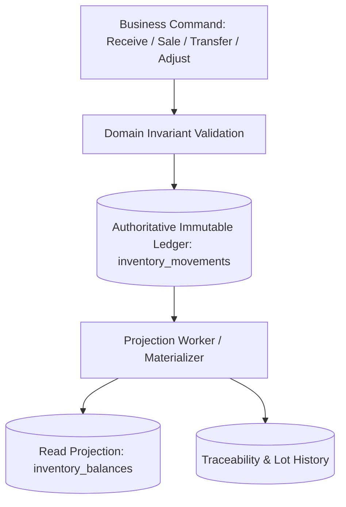
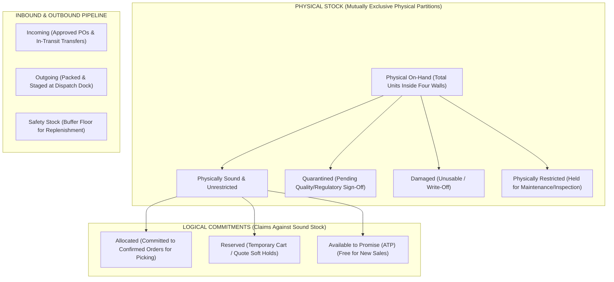

# STOKROVA Master Inventory Model & Movement Engine

## 1. Foundational Architecture: Authoritative Ledger vs Projections

STOKROVA strictly distinguishes between **Authoritative Historical Truth** and **Read-Optimized Projections**:

### The Invariant Law of Inventory Truth
$$\text{Physical On-Hand} = \sum(\text{Valid Posted Inventory Movements})$$
- **Authoritative**: `inventory_movements` (Immutable append-only ledger).
- **Projection**: `inventory_balances` (Materialized cache for fast UI lookups).
- Any discrepancy between the balance table and the ledger is resolved by recalculating from the ledger. No operation may directly modify the balance table without a corresponding ledger entry.

---

## 2. Decoupling Physical Stock States from Commitment States

### Critical Architectural Correction: Preventing Double-Counting
Stock sitting inside a warehouse exists in a **Physical State** (where it physically resides and its physical condition). 
Simultaneously, commercial orders place **Commitments** (logical claims) against that physical stock. 

A reserved or allocated item **physically remains in the warehouse on-hand**. Treating reservations and allocations as separate physical partitions leads to catastrophic double-counting.

STOKROVA strictly decouples **Physical Stock States** from **Logical Commitment States**:

---

## 3. Authoritative Inventory Equations

### Equation 1: Physical On-Hand Partition
$$\text{Physical On-Hand} = \text{Physically Unrestricted} + \text{Quarantined} + \text{Damaged} + \text{Physically Restricted}$$
- These four physical buckets are **mutually exclusive**. An item physically sits in a standard shelf, a quarantine cage, or a damaged bin.

### Equation 2: Physically Sound Stock
$$\text{Physically Unrestricted} = \text{Physical On-Hand} - (\text{Quarantined} + \text{Damaged} + \text{Physically Restricted})$$

### Equation 3: Available to Promise (ATP)
$$\text{Available to Promise (ATP)} = \text{Physically Unrestricted} - (\text{Allocated} + \text{Reserved})$$
- This is the exact quantity that can be added to a new sales cart or quotation without over-selling.

### Equation 4: Net Salable Stock (Buffer Floor)
$$\text{Net Salable Stock} = \max(0, \text{ATP} - \text{Safety Stock})$$
- When net salable stock reaches zero, automated replenishment triggers fire even if ATP is still positive.

### Equation 5: Projected Future Availability
$$\text{Projected Available} = \text{Physical On-Hand} + \text{Incoming (Approved POs \& Transfers)} - (\text{Allocated} + \text{Reserved})$$

---

## 4. Data Derivation & Ownership Matrix

| Inventory Metric | State Classification | Derivation Source | Authority Level |
| :--- | :--- | :--- | :--- |
| **Physical On-Hand** | Physical Partition | $\sum(\text{inventory\_movements})$ across physical bins | **Authoritative (Ledger-Derived)** |
| **Quarantined** | Physical Partition | Movements into `QUARANTINE` storage locations | **Authoritative (Ledger-Derived)** |
| **Damaged** | Physical Partition | Movements into `DAMAGED` storage locations | **Authoritative (Ledger-Derived)** |
| **Allocated** | Logical Commitment | Sum of unpicked line items on confirmed `SalesOrder` records | **Projected / Aggregated** |
| **Reserved** | Logical Commitment | Sum of active cart reservations with active TTL | **Cached / Ephemeral (Redis)** |
| **Incoming** | Pipeline State | Unreceived quantities on approved `PurchaseOrder` & in-transit transfers | **Calculated** |
| **Outgoing** | Pipeline State | Packed cartons awaiting carrier manifest dispatch | **Calculated** |
| **Available to Promise (ATP)**| Commercial Availability | Calculated dynamically: $\text{Unrestricted} - (\text{Allocated} + \text{Reserved})$ | **Calculated (Deterministic)** |
| **Safety Stock** | Policy Parameter | Configured floor threshold per variant and branch | **Configured Master Data** |

---

## 5. The 13 Core Inventory Movement Types

Every physical change to the ledger carries an explicit, typed business reason:

| Movement Type Code | Direction | Triggering Business Event | Physical Partition Affected |
| :--- | :---: | :--- | :--- |
| `OPENING_BALANCE` | + | Initial stock intake during system onboarding | Physically Unrestricted |
| `PURCHASE_RECEIPT` | + | Inbound stock received from vendor via GRN | Unrestricted or Quarantine |
| `SALE_ISSUE` | - | Outbound goods fulfilled and dispatched to customer | Physically Unrestricted (Allocated) |
| `CUSTOMER_RETURN` | + | Goods returned by customer | Quarantine (for inspection) |
| `SUPPLIER_RETURN` | - | Goods returned to vendor (defects/overstock) | Damaged or Unrestricted |
| `TRANSFER_OUT` | - | Stock dispatched to another branch/warehouse | Dispatched from Source Bin |
| `TRANSFER_IN` | + | Stock received from another branch/warehouse | Received into Dest Bin |
| `DAMAGE` | Net 0 / Reclass | Stock transferred from sound bin to damaged bin | Unrestricted $\rightarrow$ Damaged |
| `EXPIRY` | - | Expired perishables or pharmaceuticals discarded | Quarantined $\rightarrow$ Scrapped |
| `ADJUSTMENT` | +/- | Discretionary stock correction with reason code | Affects specific target bin |
| `STOCK_COUNT_ADJUSTMENT`| +/- | Discrepancy identified during blind stocktake | Reconciled against counted bin |
| `QUARANTINE_RELEASE` | Net 0 / Reclass | Quality inspection passes; goods moved to active bin | Quarantined $\rightarrow$ Unrestricted |
| `QUARANTINE_REJECT` | Net 0 / Reclass | Quality inspection fails; goods moved to return bin | Quarantined $\rightarrow$ Damaged |

---

## 6. Lots, Batches & Expiry (FEFO Engine)

For goods with manufacture and expiration dates (food, beverages, pharmaceuticals, chemicals):
1. **Batch Master**: Stores `batch_number`, `variant_id`, `manufacture_date`, `expiry_date`, and supplier reference.
2. **FEFO Picking Priority**:
   $$\text{Pick Order} = \text{ORDER BY expiry\_date ASC, created\_at ASC}$$
   The system automatically guides warehouse pickers to the batch expiring soonest (First Expired, First Out).
3. **Expiry Alert Pipeline**:
   - `EXPIRED`: Automatic quarantine status preventing sale or allocation.
   - `NEAR_EXPIRY`: Configurable warning window (30/60/90 days) alerting managers to discount or transfer stock.

---

## 7. Discrete Serial Number Tracking

For unique serialized items (electronics, appliances, machinery, high-value assets):
1. **Discrete Unit Record**: Every individual physical unit has a unique `serial_number`.
2. **Lifecycle State Machine**:
   $$\text{INTAKE} \longrightarrow \text{IN\_STOCK} \longrightarrow \text{ALLOCATED} \longrightarrow \text{SOLD} \longrightarrow [\text{RETURNED} \mid \text{WARRANTY\_REPLACE} \mid \text{SCRAPPED}]$$
3. **Single Location Invariant**: A serialized item can exist in exactly one location and state at any point in time. It can never be simultaneously in two warehouses or sold twice.
4. **Genealogy Trail**: The serial record maintains complete history: which supplier delivered it, which GRN received it, which bin held it, which customer bought it, and warranty expiration dates.
