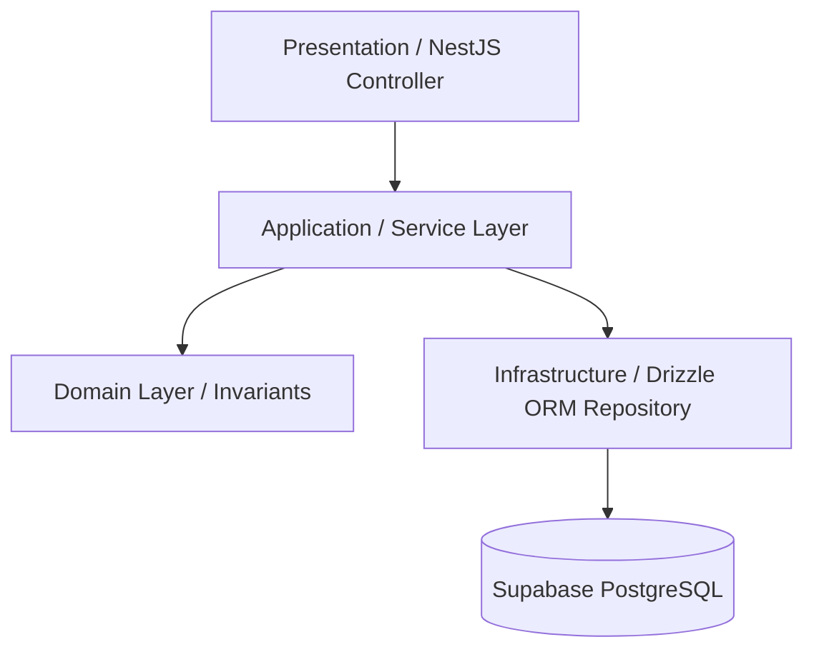

# STOKROVA Master Module Map & Dependency Boundaries

## 1. Monorepo Package Topology

```text
c:\Users\Emerm\Desktop\STOKROVA\
├── apps/
│   ├── api/                 # NestJS Authoritative Business Core (Modular Monolith)
│   ├── admin-web/           # React + Vite Admin Management Console
│   ├── pos-desktop/         # React + Tauri 2 Desktop Point-of-Sale
│   └── mobile/              # React Native + Expo Handheld Audit & POS
│
├── packages/
│   ├── contracts/           # TypeScript interfaces, types, DTOs, API contracts
│   ├── domain/              # Pure business rules, invariants, algorithms (Zero deps)
│   ├── validation/          # Zod validation schemas matching contracts
│   ├── database/            # Drizzle ORM schemas, migrations, relations (PostgreSQL)
│   ├── ui/                  # Shared UI components, tokens, design system
│   └── sync/                # Client-side SQLite synchronization engine
```

### Critical Architectural Rule: Zero Dependency Pollution in Domain
`packages/domain` contains zero external dependencies. Pure functions and domain invariants are testable in milliseconds without database connections or web servers.

---

## 2. Server Modular Monolith Layout (`apps/api/src/`)

```text
apps/api/src/
├── auth/                    # Supabase Auth JWT guards & decorators
├── tenancy/                 # Tenant, company, branch provisioning & isolation
├── rbac/                    # Scoped dynamic RBAC guards & role management
├── catalog/                 # Products, variants, attributes, barcodes, UOMs
├── pricing/                 # Price lists, branch overrides, discounts, taxes
├── inventory/               # 8-tier location hierarchy, balances, lots, serials
├── stock-movements/         # Append-only immutable movement ledger service
├── work-centers/            # Workstations, branch facilities
├── registers/               # Cash registers, till sessions, float & variance
├── workflows/               # Directed Acyclic Graph (DAG) workflow engine
├── rules/                   # Declarative business rules & approval policies
├── sales/                   # Orders, quotes, retail POS carts, wholesale orders
├── customers/               # Customer accounts, credit limits, statements
├── procurement/             # Suppliers, RFQs, purchase orders, goods receipts
├── payments/                # Idempotent payments, methods, receipt printing
├── finance/                 # General ledger, chart of accounts, journal entries
├── fulfillment/             # Pick lists, packing verification, carrier dispatch
├── manufacturing/           # Bills of materials (BOM), work orders, assembly
├── intelligence/            # ADS forecasting, reorder points, replenishment
├── sync/                    # Idempotent inbox & monotonic change feed
├── documents/               # Document numbering, PDF generation & export
├── notifications/           # In-app, email, SMS, and webhook alert dispatcher
├── search/                  # Fast multi-entity search index
├── files/                   # Cloudflare R2 object storage provider abstraction
├── audit/                   # Append-only audit logging & security event monitor
└── health/                  # Health & readiness probes
```

---

## 3. Standard Internal Module Layering

Every module strictly implements four architectural layers:

```text
module/
  ├── domain/                # Pure invariants, value objects, domain logic
  ├── application/           # Use-case orchestration services (commands/queries)
  ├── infrastructure/        # Drizzle repositories, external adapters
  └── presentation/          # NestJS Controllers, DTO validation pipes
```



- **Domain Layer**: Contains pure business rules (e.g. `assertNonNegativeStock`, `calculateVariance`). Never references HTTP, NestJS controllers, or database queries.
- **Application Layer**: Orchestrates use cases (e.g. `CompleteSaleService`, `ClaimTaskService`). Coordinates transactions across repositories.
- **Infrastructure Layer**: Implements persistence via Drizzle ORM, connects to Redis queues, and calls Cloudflare R2.
- **Presentation Layer**: Exposes `/v1/` REST endpoints, parses request envelopes, and validates payloads using Zod pipes.

---

## 4. Cross-Module Communication Rules

1. **Direct Database Joins Across Module Boundaries Are Forbidden**: A module may not perform arbitrary SQL joins across another module's internal tables.
2. **Communication via Typed Interfaces**: Modules communicate through exported NestJS application services or asynchronous domain events.
3. **Atomic Multi-Module Transactions**: When an operation spans multiple modules (e.g., `SaleCompleted` writing to `stock_movements`, `invoices`, and `journal_entries`), orchestration takes place in the application use-case within a single transactional boundary.
