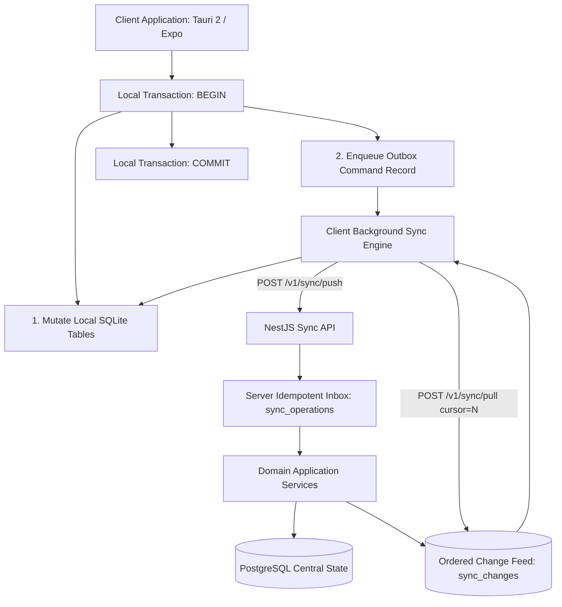
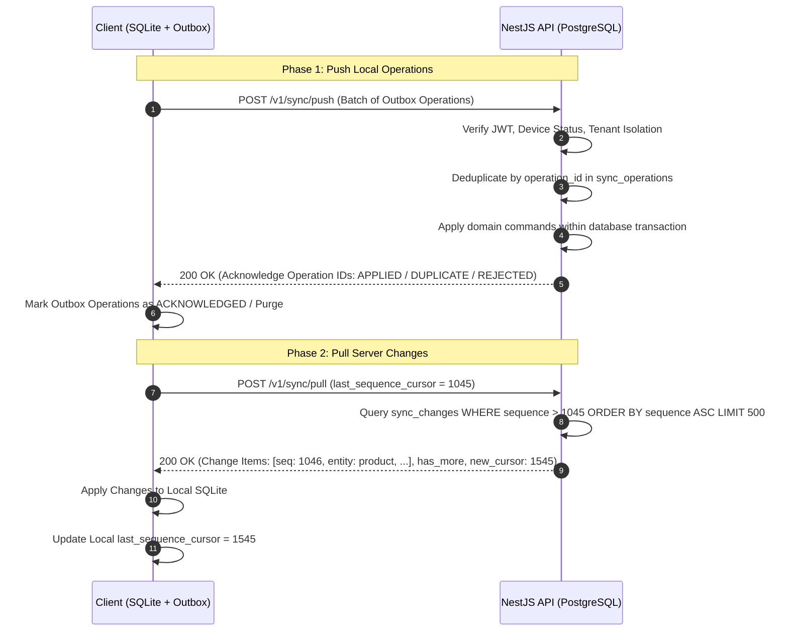

# STOKROVA Master Offline-First & Synchronization Model

## 1. Foundational Architecture

> **Rule 10: Never use global last-write-wins for business-critical conflicts.**
> **Rule 19: Always make critical commands idempotent.**
> **Rule 24: Always make offline behavior explicit.**

STOKROVA is designed from the ground up as a **local-first, offline-capable platform**. Handheld mobile audit scanners and desktop POS terminals maintain a local transactional **SQLite** database and can execute sales, stock counts, and picks with zero internet connectivity.



---

## 2. Client-Side Atomic Local Transaction

When an offline action occurs (e.g. Cashier completes an offline sale), the client executes a single atomic SQLite transaction:

```sql
BEGIN TRANSACTION;
-- 1. Insert local domain record
INSERT INTO sales_orders (id, total_minor, status, ...) VALUES ('0191...', 1500000, 'COMPLETED', ...);
INSERT INTO payments (id, operation_id, amount_minor, ...) VALUES ('0191...', '0191-op-xyz', 1500000, ...);
INSERT INTO inventory_movements (id, variant_id, qty, movement_type, ...) VALUES ('0191...', 'v-01', -1, 'SALE_ISSUE', ...);

-- 2. Insert into local outbox queue
INSERT INTO outbox_operations (
  operation_id, command, payload, idempotency_key, created_at, status
) VALUES (
  '0191-op-xyz', 'commands.sales.create', '{"order_id": "0191...", ...}', '0191-op-xyz', datetime('now'), 'PENDING'
);
COMMIT;
```
The domain mutation and the outbox entry succeed or fail together. An uncommitted command is never left in an ambiguous state.

---

## 3. Bidirectional Synchronization Protocol



---

## 4. Deterministic Conflict Resolution Strategy

STOKROVA strictly rejects naive Last-Write-Wins (LWW) for financial and inventory data:

| Entity / Domain Category | Conflict Policy | Resolution Logic |
| :--- | :--- | :--- |
| **Inventory Movements** | **IMMUTABLE_APPEND** | Both movements are valid physical occurrences. Both append to the ledger; mathematical sum reflects net physical reality. |
| **Payments & Refunds** | **IMMUTABLE_APPEND** | Financial records never overwrite. Retrying the same `operation_id` returns the cached original result (Idempotent replay). |
| **Catalog Master Data** | **SERVER_WINS** | If a product name or category is updated concurrently, the authoritative server version supersedes client local edits. |
| **Customer Master Records** | **DOMAIN_EXCEPTION** | Concurrent conflicting updates (e.g., credit limit modified offline while server updated address) generate a review task in the Manager Inbox. |

---

## 5. Network Recovery & Exponential Backoff

Client sync engines monitor connection health across 5 explicit states:
- `ONLINE`: Active network connection; push and pull execute continuously.
- `OFFLINE`: Network unavailable; operations buffer locally in SQLite outbox.
- `RECONNECTING`: Network detected; performing handshake and device verification.
- `SYNCING`: Actively pushing outbox batches and pulling change feeds.
- `SYNC_ERROR`: Transient error encountered; engine retries using jittered exponential backoff:
  $$\text{Delay} = \min(60\text{s}, 2^{\text{retry\_count}} \times 1\text{s}) + \text{random\_jitter}(0, 500\text{ms})$$
