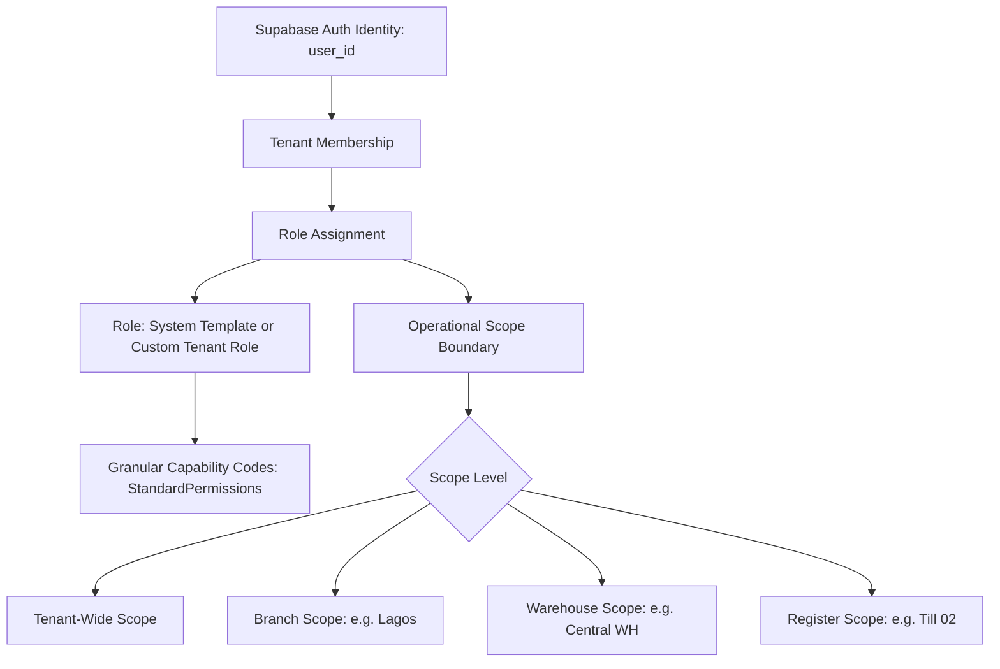

# STOKROVA Master Permission & Scoped RBAC Model

## 1. Core Architectural Separations

> **Rule 2: Never assume one role per user.**
> **Rule 3: Never assume one branch per user.**
> **Rule 9: Never rely on client-side authorization.**

STOKROVA strictly maintains clear conceptual boundaries between:

```text
PERMISSION   -> What is this user allowed to do? (Capability codes)
ASSIGNMENT   -> Who should perform this task? (Specific user, role, team, work center)
WORKFLOW     -> What happens next? (DAG orchestration)
RULE         -> Under what conditions should something occur? (Declarative criteria)
```

These four concepts are never collapsed or conflated.

---

## 2. Multi-Dimensional Scoped Dynamic RBAC

Authorization decouples identity from rigid application roles:



### Scope Hierarchy
A role assignment is constrained to an explicit operational boundary:
1. `TENANT`: Applies across the entire organization.
2. `COMPANY`: Constrained to a specific legal entity.
3. `BRANCH`: Constrained to a physical trading branch.
4. `WAREHOUSE`: Constrained to a specific physical storage facility.
5. `REGISTER`: Constrained to a single cash drawer/register.
6. `WORK_CENTER`: Constrained to a physical station (e.g. Verification Bench).

### Multi-Role Capability
A user can hold multiple roles with differing scopes:
- User Alice may be a **Branch Manager** in Branch Lagos.
- In Branch Abuja, she may hold only **Auditor** permissions.
- On Register 01, she may hold **Cashier** permissions.

---

## 3. Platform Super Admin vs Tenant Business Owner

STOKROVA enforces a strict security segregation between SaaS infrastructure operations and tenant commercial operations:

```text
                        PLATFORM SUPER ADMIN (SaaS Layer)
                                      │
                        ├── Tenant Provisioning & Suspension
                        ├── Global Infrastructure Diagnostics
                        ├── Database Health & Telemetry
                        └── Worker / Sync Queue Monitoring
                                      │
              ════════════════════════╪════════════════════════
                        CRITICAL SECURITY BOUNDARY
              ════════════════════════╪════════════════════════
                                      │
                       TENANT BUSINESS OWNER (Commercial Layer)
                                      │
                        ├── Employee Management & RBAC Roles
                        ├── Branches & Warehouses
                        ├── Commercial Catalog & Pricing
                        ├── Financial General Ledger & Cash Truth
                        └── Workflow Definitions & Approvals
```

### Security Invariant
Platform Super Admins are strictly prohibited from accessing tenant commercial data, financial ledgers, or customer accounts through standard APIs. Any emergency support access requires audited, time-bounded elevation.

---

## 4. Granular Capability Permissions Catalog

All permissions are strongly-typed capability codes (`StandardPermissions`):

```typescript
export const StandardPermissions = {
  // Identity & Tenancy
  TENANTS_VIEW: 'tenants.view',
  TENANTS_MANAGE: 'tenants.manage',
  USERS_VIEW: 'users.view',
  USERS_MANAGE: 'users.manage',
  ROLES_VIEW: 'roles.view',
  ROLES_MANAGE: 'roles.manage',

  // Catalog & Pricing
  CATALOG_VIEW: 'catalog.view',
  CATALOG_MANAGE: 'catalog.manage',
  PRICING_VIEW: 'pricing.view',
  PRICING_MANAGE: 'pricing.manage',

  // Inventory & Locations
  INVENTORY_VIEW: 'inventory.view',
  INVENTORY_ADJUST: 'inventory.adjust',
  INVENTORY_TRANSFER: 'inventory.transfer',
  INVENTORY_COUNT: 'inventory.count',

  // Commerce & Sales
  SALES_VIEW: 'sales.view',
  SALES_CREATE: 'sales.create',
  SALES_REFUND: 'sales.refund',
  SALES_DISCOUNT_OVERRIDE: 'sales.discount_override',

  // Cash Registers
  REGISTERS_VIEW: 'registers.view',
  REGISTERS_OPEN: 'registers.open',
  REGISTERS_CLOSE: 'registers.close',
  REGISTERS_CASH_MOVE: 'registers.cash_move',

  // Operations & Workflows
  WORKFLOW_VIEW: 'workflow.view',
  WORKFLOW_MANAGE: 'workflow.manage',
  TASKS_CLAIM: 'tasks.claim',
  TASKS_COMPLETE: 'tasks.complete',
  APPROVALS_GRANT: 'approvals.grant',

  // Devices & Sync
  DEVICES_MANAGE: 'devices.manage',
  SYNC_PUSH: 'sync.push',
  SYNC_PULL: 'sync.pull',

  // Finance & Audit
  FINANCE_VIEW: 'finance.view',
  FINANCE_POST: 'finance.post',
  AUDIT_VIEW: 'audit.view',
} as const;
```

---

## 5. Server-Side Enforcement (RbacGuard)

Authorization is verified strictly on the server:
$$\text{EvaluatePermissionScope}(\text{User Assignments}, \text{Required Permission}, \text{Target Resource Scope})$$
Any attempt by a client to execute an operation outside their authorized scope triggers an immediate `403 Forbidden` and logs a security audit event.
