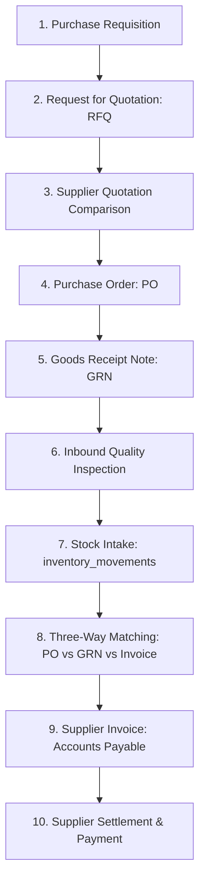

# STOKROVA Master Procurement & Supplier Model

## 1. Procurement Lifecycle

The STOKROVA procurement engine manages the inbound supply chain from initial internal material requisitions through supplier settlement:

---

## 2. Core Procurement Stages

### Stage 1: Purchase Requisition & RFQs
- Internal requisitions generated manually by branch staff or automatically by the **Replenishment Engine** (when stock drops below Reorder Point).
- Requests for Quotation (RFQs) dispatched to multiple approved vendors.
- Vendor price bids and stated lead times compared in an evaluation matrix.

### Stage 2: Purchase Orders (PO)
- Legally binding commercial contract containing vendor SKU, agreed price, delivery dates, and payment terms.
- High-value POs route through declarative approval rules (e.g., POs $> ₦5,000,000$ require executive approval).

### Stage 3: Goods Receipt Note (GRN) & Inspection
- Receiving dock verifies physical shipment against the PO.
- Partial receipts supported: lines remain open until fully received or closed.
- Quality Inspection routes:
  - **Passed**: Immediately posted to `inventory_movements` as `PURCHASE_RECEIPT` into available warehouse bins.
  - **Quarantine**: Placed in temporary holding bin awaiting lab/testing sign-off.
  - **Rejected**: Tagged for supplier return with photographic evidence and defect codes.

### Stage 4: Three-Way Matching & Invoicing
The system enforces the classic financial audit invariant before Accounts Payable approval:
$$\text{Purchase Order (Agreed Price \& Qty)} \longleftrightarrow \text{Goods Receipt (Physical Qty Received)} \longleftrightarrow \text{Supplier Invoice (Billed Amount)}$$
- Discrepancies generate variance flags for manager review before payment authorization.

---

## 3. Landed Cost Allocation

For imported or freighted inventory, the procurement engine distributes additional landed costs across received items:
$$\text{Total Landed Cost} = \text{Purchase Price} + \text{Freight} + \text{Customs / Tariffs} + \text{Insurance} + \text{Handling}$$
Costs can be allocated across line items by:
1. **Value Proportion**: Allocated based on total purchase value.
2. **Quantity Proportion**: Allocated based on total units received.
3. **Weight / Volume Proportion**: Allocated based on physical freight weight.
Landed costs adjust the inventory valuation base without mutating historical supplier purchase prices.

---

## 4. Supplier Intelligence & Performance Metrics

The procurement engine continuously calculates supplier reliability scores:
- **On-Time Delivery Rate (OTD)**:
  $$\text{OTD \%} = \frac{\text{Receipts Delivered on or before Promise Date}}{\text{Total Orders}} \times 100$$
- **Defect / Rejection Rate**:
  $$\text{Defect \%} = \frac{\text{Rejected Inspection Quantity}}{\text{Total Received Quantity}} \times 100$$
- **Price Stability Index**: Historical tracking of price fluctuations across procurement cycles.
