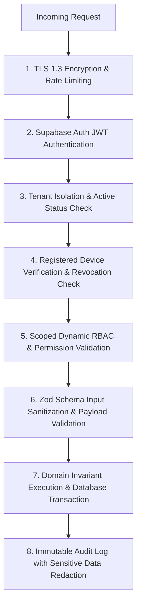

# STOKROVA Master Security & Governance Model

## 1. Zero-Trust Security Philosophy

STOKROVA operates under a **Zero-Trust Security Architecture**:

> **Assume the client application and network are untrusted. Every business command, authorization check, and inventory invariant is authoritatively verified on the server.**

---

## 2. Security Defense Architecture

---

## 3. Registered Device Trust & Revocation

POS terminals and mobile audit scanners must be explicitly registered before participating in offline synchronization:

1. **Device Registration (`/v1/devices/register`)**:
   - Stores device platform (Desktop Tauri, Mobile Expo), hardware fingerprint, and assigned branch/work center.
   - Issues a unique device registration token.
2. **Instant Revocation (`/v1/devices/revoke`)**:
   - If a mobile scanner is lost, stolen, or compromised, a branch manager can revoke the device instantly.
   - Any subsequent sync attempt by the revoked device is immediately rejected, locking local client operation.

---

## 4. Sensitive Data Sanitization & Audit Redaction

To maintain compliance and protect user privacy:
1. **Automated Field Redaction**: The audit engine automatically strips or masks sensitive attributes before persisting audit logs:
   - Passwords, authentication secrets, API tokens
   - Credit card numbers (PANs) and CVVs
   - Bank verification numbers and personal identification tokens
2. **Tamper-Resistant Append-Only Logs**:
   - The `audit_events` and `security_events` tables strictly disallow `UPDATE` and `DELETE` operations.
   - Records capture: `tenant_id`, `actor_user_id`, `device_id`, `action`, `resource_type`, `resource_id`, `ip_address`, `timestamp`.

---

## 5. Security Incident Severity Classification

Security violations are categorized and alerted according to risk:
- `CRITICAL`: Cross-tenant access attempt, revoked device communication, corrupted payment payload. Triggers immediate admin alerts and session invalidation.
- `HIGH`: Brute-force authentication failures, unauthorized manager discount override attempts.
- `MEDIUM`: Expired token presentations, invalid CSRF headers.
- `LOW`: Routine token refresh events, session logouts.
