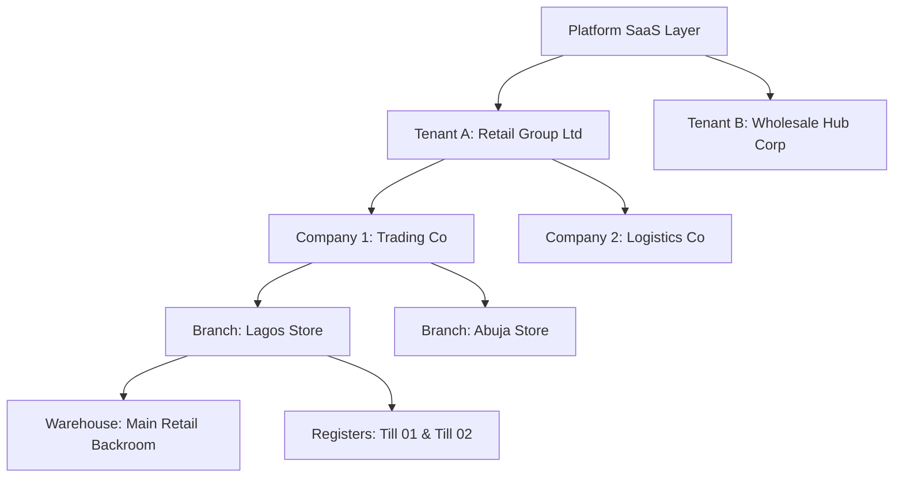

# STOKROVA Master Multi-Tenancy Model

## 1. Tenancy Architectural Hierarchy

STOKROVA is an enterprise multi-tenant platform where multiple corporate organizations execute on a shared infrastructure without cross-tenant data leakage:



---

## 2. Server-Side Tenant Isolation Invariants

> **Rule 21: Always preserve tenant isolation.**

1. **Mandatory Tenant Scoping**: Every business table in PostgreSQL carries an explicit, non-nullable `tenant_id uuid NOT NULL REFERENCES tenants(id)`.
2. **Server-Side Enforcement**: All NestJS repositories and services inject the tenant context extracted from the validated JWT token:
   ```typescript
   // Guaranteed tenant scoping in all queries
   const records = await db
     .select()
     .from(products)
     .where(and(eq(products.tenant_id, tenantId), eq(products.is_active, true)));
   ```
3. **Rejection of Client-Supplied Tenant IDs**: If an API request attempts to pass a `tenant_id` in the body or query parameter that differs from the authenticated session's tenant token, the request is immediately rejected with a `403 Forbidden` and logged as a high-severity security incident.
4. **Supabase Row-Level Security (RLS) Defense-in-Depth**: PostgreSQL RLS policies enforce tenant isolation at the database layer as a second line of defense behind the application layer.

---

## 3. Administrative Tier Separation

```text
                                PLATFORM SUPER ADMIN
                                        │
                        ├── Tenant Provisioning & Suspension
                        ├── Global Infrastructure Diagnostics
                        └── System Performance Telemetry
                                        │
                      ═════════════════════════════════
                               ISOLATION GATE
                      ═════════════════════════════════
                                        │
                              TENANT BUSINESS OWNER
                                        │
                        ├── Corporate Identity & Legal Companies
                        ├── Branches, Warehouses & Tills
                        ├── Users, Roles & Work Centers
                        └── Financial Truth & Commercial Ledgers
```

Platform Super Admins are strictly barred from querying or altering tenant business ledgers, customer credit, or financial transactions through standard operational APIs.
