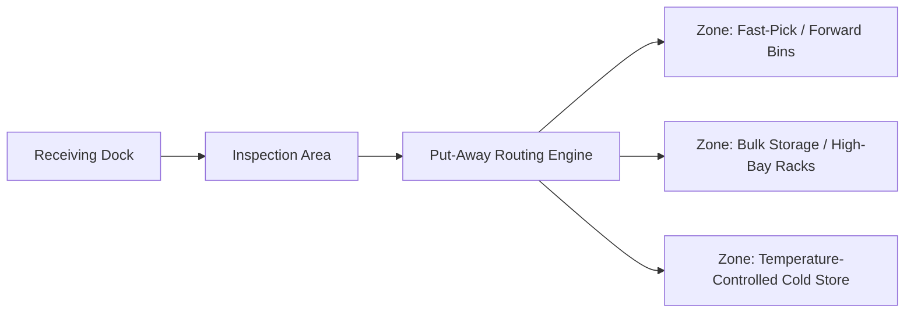
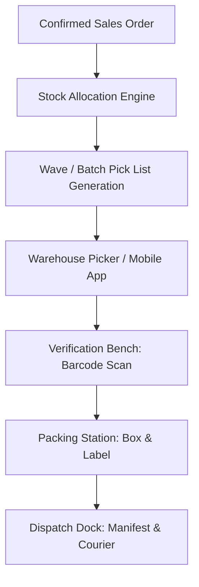
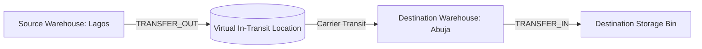

# STOKROVA Master Warehouse & Logistics Model

## 1. Physical Location Topology (8-Tier Hierarchy)

The warehouse domain models physical spaces with extreme granularity, supporting operations from small backrooms to multi-acre distribution hubs:

```text
Tenant
  └── Company / Legal Entity
        └── Branch (e.g., Lagos Operations)
              └── Warehouse (e.g., Main Central Logistics Hub)
                    └── Zone (e.g., Cold Store, Bulk Storage, Fast-Pick Area)
                          └── Aisle (e.g., Aisle 04)
                                └── Rack (e.g., Rack B)
                                      └── Shelf (e.g., Level 02)
                                            └── Bin (e.g., Bin 15)
```

### Materialized Path Indexing
To achieve sub-millisecond tree traversals without recursive SQL queries, every location maintains a canonical materialized path:
```text
LAGOS/WH-01/ZONE-BULK/AISLE-04/RACK-B/SHELF-02/BIN-15
```
A B-Tree index on `(tenant_id, materialized_path text_pattern_ops)` enables instant prefix filtering across entire aisles or zones in a single index scan.

---

## 2. Inbound Put-Away & Receiving Operations



1. **Receiving Dock**: Initial receipt and unboxing.
2. **Put-Away Routing Rules**:
   - High-velocity items routed to lower shelves and forward picking areas.
   - Perishables routed to temperature-controlled zones.
   - Bulk pallets routed to upper high-bay racks.
3. **Barcode Location Tagging**: Pickers scan the item barcode followed by the bin location barcode to confirm put-away.

---

## 3. Outbound Fulfillment Pipeline



### Wave & Batch Picking
- **Single Order Pick**: For large wholesale or palletized orders.
- **Batch / Wave Pick**: Aggregates items for multiple small orders into a single warehouse pick run, sorting items into pick carts at the verification bench.
- **Routing Optimization**: Pick lists ordered by location path to minimize walking distance through warehouse aisles.

---

## 4. Verification & Packing Benches

To eliminate shipping errors:
1. **Secondary Barcode Verification**: Every picked item scanned at the verification work center against the order manifest.
2. **Serial & Expiry Validation**: Enforces capture of discrete unit serial numbers and validates that picked batches match FEFO rules.
3. **Packing Slip & Carton Labels**: Generates standardized packing slips with box contents, weight, and barcode shipping labels.

---

## 5. Multi-Branch & Inter-Facility Transfers



- Dispatched stock removed from the source warehouse and transferred to a designated **Virtual Transit Location**.
- Stock in transit remains visible on company balance sheets as an asset, but cannot be sold by either branch until physically received.
- Destination receiving clerk inspects shipment:
  - **Match**: Exact quantity posted to destination inventory.
  - **Discrepancy (Transit Loss/Damage)**: Reconciled via audited `TRANSIT_LOSS` adjustment movement.
