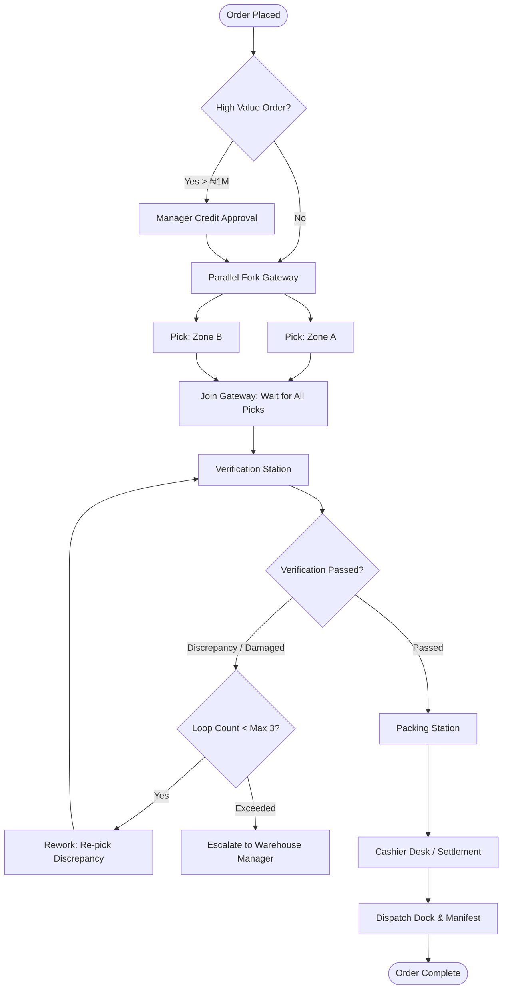
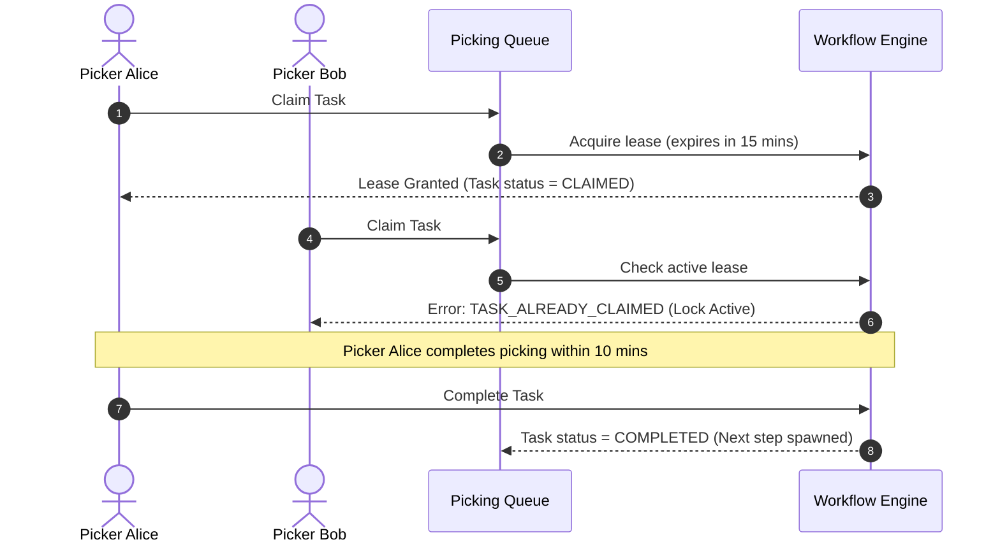

# STOKROVA Master Workflow & Operations Model

## 1. Operations Subsystem Role

> **Rule 1: Never hard-code one business workflow.**
> **Rule 5: Never allow workflow configuration to bypass domain invariants.**
> **Rule 23: Always keep workflow orchestration separate from domain invariants.**

The workflow engine is an **operations subsystem**, not the platform itself. It orchestrates execution flow across business domains:
- **What happens next?**
- **Who should perform this task?**
- **Under what conditions should branching, retries, or rework occur?**

The workflow engine orchestrates transitions between domain operations (Sales $\rightarrow$ Warehouse $\rightarrow$ Cashier), but **never** performs direct balance mutations or bypasses accounting/inventory rules.

---

## 2. Directed Workflow Graph with Bounded Execution

### Architectural Correction: From Strict DAG to Directed Workflow Graph
A strict Directed Acyclic Graph (DAG) forbids cycles. However, real-world business operations fundamentally require **controlled loops, retries, rework, and failure recovery** (e.g., Pick $\rightarrow$ Verify $\rightarrow$ Defect Found $\rightarrow$ Re-pick $\rightarrow$ Verify).

STOKROVA models workflows as a **Directed Workflow Graph with Validated Transitions, Controlled Loops, Retries, and Bounded Execution**:



---

## 3. Workflow Node Types & Execution Behaviors

| Node Type | Execution Behavior | Failure / Rework Capability |
| :--- | :--- | :--- |
| `USER_TASK` | Enqueues a task routed to a specific user, role, work center, or queue | Can be marked as `FAILED` or `REJECTED`, routing to rework transitions. |
| `APPROVAL` | Requires designated manager sign-off before proceeding | Can be `REJECTED`, routing to cancellation, amendment, or escalation. |
| `SYSTEM_ACTION` | Executes automated domain command within transaction | Supports configurable retry policies (e.g. 3 retries with exponential backoff). |
| `CONDITIONAL_GATEWAY` | Evaluates declarative rules to branch execution path | Deterministic evaluation of business conditions (zero code execution). |
| `PARALLEL_GATEWAY` | Spawns multiple concurrent child tasks simultaneously | All parallel paths run concurrently until synchronized at a Join Gateway. |
| `JOIN_GATEWAY` | Synchronizes execution; waits for all or $N$ parallel tasks | Timeout behavior: escalates if child tasks fail to complete within SLA. |
| `CONTROLLED_LOOP` | Routes execution back to an earlier step for rework | Enforces strict iteration bounds to prevent infinite cycles. |
| `ESCALATION` | Reassigns tasks or notifies higher management upon SLA breach | Triggers when loop limits or response timeouts are reached. |

---

## 4. Loop Bounds & Anti-Cycle Guardrails

To prevent accidental or malicious runaway loops while permitting legitimate operational rework:

1. **Explicit Hop Counter (`execution_hop_count`)**:
   - Every state transition increments a monotonic instance counter.
   - Hard execution ceiling: An instance terminating more than 50 transitions is halted and flagged as `EXECUTION_LIMIT_EXCEEDED` for administrative review.
2. **Loop Iteration Guards (`max_iterations`)**:
   - Any transition pointing backwards to an ancestor step must declare a loop guard (default maximum: 3 iterations).
   - If a pick verification fails 3 times, the workflow transitions to `ESCALATE_TO_SUPERVISOR` rather than re-looping indefinitely.
3. **Step Timeout & SLA Expiration**:
   - Steps define maximum lease/dwell times. If a task remains uncompleted past its SLA, the workflow engine automatically fires configured escalation transitions.

---

## 5. Task Queues & Lease-Based Concurrency Locking

In high-throughput facilities, multiple workers process shared task queues (e.g., Warehouse Picking Queue):



### Concurrency Rules
1. **Prevent Duplicate Work**: Two workers can never claim the same order or pick list simultaneously.
2. **Lease Expiration & Heartbeats**: If a worker claims a task and abandons it (device battery dies), the lease expires automatically, returning the task to `PENDING` in the shared queue.

---

## 6. Declarative Business Rules Engine

> **Rule 6: Never execute arbitrary tenant-supplied code.**

All rule branching and approval triggers evaluate via a safe, declarative condition AST:

```json
{
  "condition_group": "AND",
  "rules": [
    {
      "field": "order.total_minor",
      "operator": "GREATER_THAN",
      "value": 100000000
    },
    {
      "field": "customer.credit_rating",
      "operator": "EQUALS",
      "value": "TIER_B"
    }
  ],
  "action": "REQUIRE_APPROVAL",
  "approval_role": "FINANCE_DIRECTOR"
}
```
Evaluation is completely deterministic with zero `eval()`, JavaScript runtime execution, or database injection vulnerabilities.

---

## 7. Workflow Versioning & Publication Immutability

> **Rule 12: Never mutate published workflow versions.**

```text
DRAFT (Editable by Business Admin)
  │
  ▼ (Publish Action - Validates graph bounds & transition integrity)
PUBLISHED (Permanently Immutable)
  │
  ▼ (Superceded by new version)
ARCHIVED (Historical audit preservation)
```
- Active transactions continue executing against the exact workflow version active when the order was placed.
- Changes to workflows create new versions (`v1 -> v2`), ensuring ongoing business transactions are never broken mid-flight.
