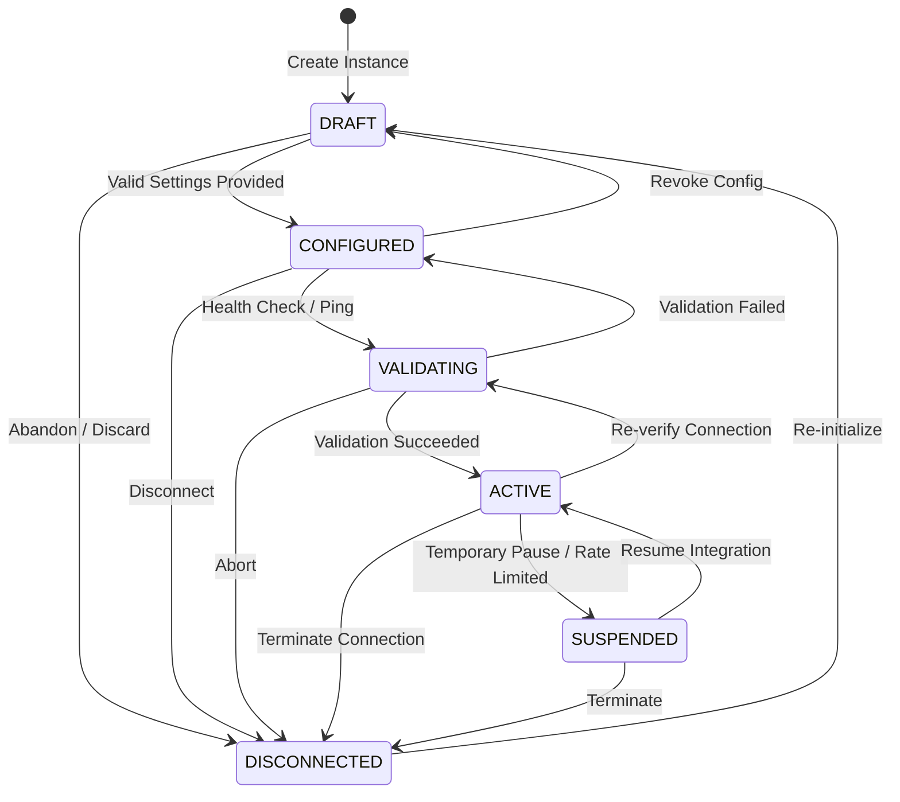

# STOKROVA Phase 12 — Integration Platform & Extensibility Model

## 1. Executive Overview & Core Architectural Principle

Phase 12 establishes STOKROVA's production-grade, multi-tenant Integration Hub, External Connectors, and Developer Platform.

The guiding invariant of the STOKROVA Integration Platform is:

> **"External systems integrate with STOKROVA's business domains; they do not create competing sources of truth."**

External integrations must never bypass domain validations, directly mutate database ledger balances or general ledger journals, or duplicate payments/orders on webhook retries. Every external interaction routes through domain-enforced application services, ensuring absolute transactional and financial consistency.

```text
       ┌───────────────────────────────────────────────────────────────┐
       │               EXTERNAL PLATFORMS & DEVELOPERS                 │
       │    Shopify • WooCommerce • Stripe • FedEx • DHL • Custom API  │
       └───────────────────────────────┬───────────────────────────────┘
                                       │ HTTPS / Webhooks
                                       ▼
       ┌───────────────────────────────────────────────────────────────┐
       │                     INTEGRATION GATEWAY                       │
       │  • Anti-SSRF Defense Filter (Blocks loopback, LAN, metadata)  │
       │  • Developer API Key Verification (SHA-256 hash lookup)       │
       │  • Rate Limiting Engine (Sliding 60s windows)                 │
       │  • Inbound Webhook Replay Protection (300s window & HMAC)     │
       │  • Deduplication Index (Provider:EventID idempotent skip)     │
       └───────────────────────────────┬───────────────────────────────┘
                                       │ Verified Payloads
                                       ▼
       ┌───────────────────────────────────────────────────────────────┐
       │                INTEGRATION HUB DOMAIN ENGINE                  │
       │  • Connector Catalog & Adapters (10 Standard Connectors)      │
       │  • Instance Lifecycle State Machine (DRAFT..ACTIVE)           │
       │  • Bidirectional Identity Mapping (External ID <-> Internal)  │
       │  • Configurable Field Mapping & Pure Transforms (Zero eval)   │
       │  • Conflict Resolution Engine (STOKROVA_WINS, MANUAL_REVIEW)  │
       │  • Reconciliation & Discrepancy Auditing                      │
       └───────────────────────────────┬───────────────────────────────┘
                                       │ Standard Commands
                                       ▼
       ┌───────────────────────────────────────────────────────────────┐
       │                  CORE DOMAIN BUSINESS INVARIANTS              │
       │  Sales Orders • Payments Service • Logistics • General Ledger │
       └───────────────────────────────────────────────────────────────┘
```

---

## 2. Platform Architecture & Data Storage

All integration tables are co-located in the primary PostgreSQL database with row-level tenant isolation:

1. `integration_instances`: Registry of configured connectors per tenant and optional branch/company.
2. `developer_api_keys`: Hashed API credentials (`ak_live_...`) with scoped permissions and rate limits.
3. `integration_credentials`: Secure references and cryptographic hashes of external secrets; plaintext is never persisted.
4. `integration_entity_mappings`: Bidirectional correlation between external system IDs and STOKROVA internal IDs.
5. `integration_field_mappings`: Declarative schema field transformation rules between external formats and internal models.
6. `integration_sync_runs`: Observable execution logs tracking batch sync runs, cursors, counts, and errors.
7. `inbound_webhook_receipts`: Audit trail of received webhooks with SHA-256 payload digests and idempotent status.
8. `integration_reconciliations`: Discrepancy records for discrepancies between STOKROVA entities and external states.
9. `integration_audit_logs`: Immutable, redacted log of all administrative and lifecycle integration events.

---

## 3. Standard Connector Definitions

STOKROVA ships with 10 standard connector definitions out of the box:

| Connector Code | Category | Key Capabilities | Auth Type | Webhooks |
| :--- | :--- | :--- | :--- | :--- |
| `ECOMMERCE_SHOPIFY` | eCommerce | Order Import, Catalog Export, Stock Sync, Webhook Ingest, Reconcile | OAuth2 / Access Token | Yes |
| `ECOMMERCE_WOOCOMMERCE` | eCommerce | Order Import, Stock Sync, Webhook Ingest, Reconcile | API Key / Consumer Secret | Yes |
| `ECOMMERCE_GENERIC` | eCommerce | Order Import, Catalog Export, Stock Sync, Bidirectional Webhook | API Key / Basic Auth | Yes |
| `PAYMENT_STRIPE` | Payment | Payment Verify, Refunds, Webhook Ingest, Reconcile | Secret Key / Webhook Secret | Yes |
| `PAYMENT_GENERIC` | Payment | Terminal Integration, Payment Verify, Refunds, Reconcile | API Key / Mutual TLS | Yes |
| `CARRIER_FEDEX` | Logistics | Rate Quoting, Label Generation, Shipment Tracking, Webhooks | OAuth2 / Client Credentials | Yes |
| `CARRIER_GENERIC` | Logistics | Dispatch Notification, Tracking Updates, Webhook Ingest | API Key / Bearer Token | Yes |
| `ACCOUNTING_QUICKBOOKS` | Accounting | GL Chart of Accounts Sync, Tax Mapping, Outbound Sync | OAuth2 | Outbound |
| `ERP_GENERIC` | ERP | Master Data Sync, Purchase Order Intake, Stock Movement | API Key / OAuth2 | Yes |
| `CUSTOM_WEBHOOK` | Webhook | Custom HTTP Notification Bus, Inbound/Outbound Dispatch | HMAC Secret / Bearer | Yes |

---

## 4. Integration Instance Lifecycle State Machine

Instances adhere to strict state transition rules to ensure operational safety:



Direct illegal transitions (e.g., jumping from `DRAFT` directly to `ACTIVE`, or attempting to operate on a `DISCONNECTED` instance without re-initialization) are rejected with domain exceptions.

---

## 5. Inbound Webhook Gateway & Deduplication

Inbound webhooks undergo 4 levels of validation before payload processing:
1. **SSRF & Payload Size Gate**: Reject payloads over 1MB.
2. **Signature Verification**: Validates HMAC-SHA256 signatures against the configured instance secret using constant-time string comparison (`constantTimeEquals`) to prevent timing side-channel attacks.
3. **Replay Tolerance Window**: Validates that incoming request timestamps fall within a strict 300-second window ($\pm 300\text{s}$) relative to server time.
4. **Idempotent Deduplication**: Checks `(tenant_id, provider, provider_event_id)`. If an event was already processed, the gateway immediately returns the cached receipt with `is_duplicate: true` and skips downstream processing.

---

## 6. Bidirectional Synchronization & Conflict Resolution

### 6.1 Identity Mappings
Every synchronized entity maintains an entry in `integration_entity_mappings`:
- `entity_type`: `ORDER`, `PRODUCT`, `INVENTORY`, `PAYMENT`, `CUSTOMER`, `SHIPMENT`.
- `internal_id`: STOKROVA primary key (e.g. `so_00192`).
- `external_id`: Remote platform ID (e.g. `gid://shopify/Order/89127391`).

### 6.2 Declarative Field Transformations (Zero Eval / Zero Code Injection)
Field transformation runs strictly without `eval` or dynamic code execution:
- `DIRECT`: Exact value pass-through.
- `ENUM_MAP`: Dictionary mapping between external codes and internal enums.
- `DATE_FORMAT`: Normalization of UNIX timestamps or strings to ISO-8601 UTC.
- `CURRENCY_MINOR`: Conversion of decimal amounts (e.g., `12.50`) to integer minor units (`1250`).
- `BASIS_POINTS`: Conversion of percentages (e.g., `15.5%`) to integer basis points (`1550`).
- `DEFAULT_VALUE`: Fallback assignment when source field is nullish.

### 6.3 Conflict Resolution Policies
When updates collide on both sides:
- `STOKROVA_WINS`: Internal state is authoritative; external record rejected or overwritten.
- `EXTERNAL_WINS`: External platform state takes precedence.
- `NEWEST_VERSION`: Timestamp comparison decides the winner.
- `MANUAL_REVIEW`: Conflict is frozen and escalated as a reconciliation discrepancy for human resolution.
