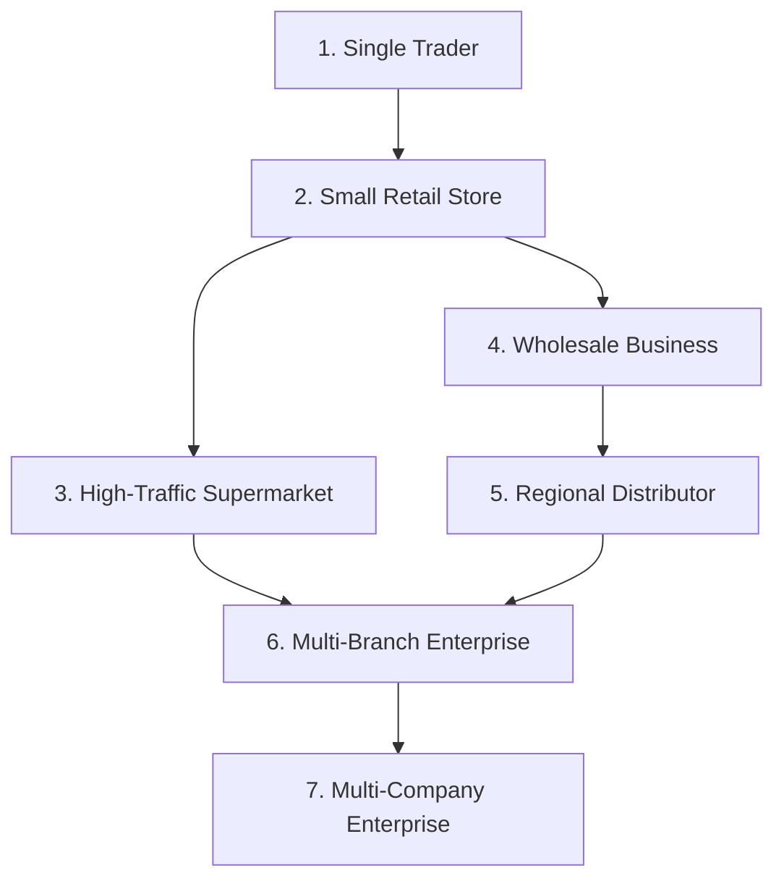

# Business Operational Modes & Progressive Complexity

## 1. Concept: Progressive Complexity Over a Single Architecture

STOKROVA does not maintain separate codebases or database schemas for small shops versus enterprise corporations. 

Instead, it implements **Progressive Complexity**: the same underlying domain engine powers every business tier. As a business expands, the platform activates capabilities and reveals operational workflows, without forcing the tenant through disruptive data migrations.

---

## 2. Supported Business Operating Profiles

---

### Profile 1: Single Trader / Solo Merchant
- **Operating Reality**: A sole proprietor running a single counter, stall, or boutique shop. Operates all roles simultaneously (owner, cashier, stock keeper).
- **Active Capabilities**: POS Checkout, Simple Catalog, Basic Stock, Daily Cash Drawer, Sales Reports.
- **Workflow Pipeline**: Instant Counter Sale:
  $$\text{Sell} \longrightarrow \text{Pay} \longrightarrow \text{Receipt} \longrightarrow \text{Done}$$
- **UI Experience**: Minimalist, distraction-free interface with no warehouse hierarchy, approval queues, or double-entry screens.

---

### Profile 2: Small Retail Store
- **Operating Reality**: A storefront with 2–5 employees (Owner, 1–2 Cashiers, 1 Stock Clerk).
- **Active Capabilities**: Multiple Cashier Accounts, Register Sessions with Float & Blind Reconciliation, Barcode Scanner, Receipt Printing, Supplier Tracking, Stock Reordering.
- **Workflow Pipeline**: Cashier Shift Workflow:
  $$\text{Open Register Float} \longrightarrow \text{Process Sales} \longrightarrow \text{Blind Closing Cash Count} \longrightarrow \text{Variance Audit}$$

---

### Profile 3: High-Traffic Supermarket
- **Operating Reality**: Multiple concurrent cashier registers, dedicated customer queues, high-speed barcode scanning, daily cash pickups.
- **Active Capabilities**: Fast 1D/2D Barcode Auto-Focus, Split Tender (Cash + POS Card + Bank Transfer), Suspended/Resumed Carts, Cash In/Cash Out Movements, Blind Till Reconciliation, Per-Register Audit.
- **Offline Resilience**: Cashiers continue scanning and processing transactions when store Wi-Fi drops, synchronizing automatically upon reconnection.

---

### Profile 4: Wholesale Business
- **Operating Reality**: Sells in bulk to retailers and commercial buyers. Offers credit terms, volume pricing, quotations, and partial fulfillment.
- **Active Capabilities**: B2B Customer Profiles, Credit Limits, Payment Terms (Net 30), Tiered Price Lists (Retail vs Wholesale vs Distributor), Quotations, Pro-Forma Invoices, Account Statements.
- **Workflow Pipeline**:
  $$\text{Quotation} \longrightarrow \text{Sales Order} \longrightarrow \text{Credit Approval} \longrightarrow \text{Picking} \longrightarrow \text{Invoice} \longrightarrow \text{Payment Later}$$

---

### Profile 5: Regional Distributor & Logistics Hub
- **Operating Reality**: High-volume distribution center supplying wholesale buyers, sub-distributors, and retail chains.
- **Active Capabilities**: Granular Storage Locations (Zones, Aisles, Racks, Shelves, Bins), Batch/Lot Expiry (FEFO), Discrete Serial Tracking, Route Planning, Dispatch Manifests, Proof of Delivery (POD).
- **Workflow Pipeline**:
  $$\text{Sales Order} \longrightarrow \text{Zone Pick List} \longrightarrow \text{Packing Slip} \longrightarrow \text{Barcode Verification} \longrightarrow \text{Carrier Dispatch} \longrightarrow \text{Delivery POD}$$

---

### Profile 6: Multi-Branch Company
- **Operating Reality**: One legal entity operating across multiple geographic retail branches and central warehouses (e.g., Lagos Central, Abuja Branch, Kano Hub).
- **Active Capabilities**: Centralized Product Catalog, Branch-Specific Pricing Overrides, Branch Stock Allocation, Inter-Branch Stock Transfers with In-Transit Tracking, Scoped Dynamic RBAC, Consolidated Company Reporting.

---

### Profile 7: Multi-Company Enterprise
- **Operating Reality**: Corporate holding company managing distinct legal business entities, multiple currencies, tax jurisdictions, and formal departmental approval matrices.
- **Active Capabilities**: Multi-Company Ledger Separation, Inter-Company Transfers, Multi-Level Bills of Materials (BOM), Declarative Approval Rules (e.g., orders $> ₦1,000,000$ require financial controller sign-off), Automated Replenishment Intelligence (ADS/ROP).

---

## 3. Comparison of Operating Profiles

| Operational Feature | Single Trader | Retail Store | Wholesale | Distributor | Multi-Branch | Enterprise |
| :--- | :---: | :---: | :---: | :---: | :---: | :---: |
| **User Roles** | 1 (Owner) | 2–3 | 3–5 | 5–10 | 10–50 | 100+ |
| **Registers/Tills** | 1 | 1–3 | 1–2 | 1 | 10+ | 50+ |
| **Warehouses** | 1 (Store) | 1 (Backroom) | 1–2 | Large Hub | Multiple | Multi-Tier |
| **Bin Locations** | Disabled | Optional | Recommended | Mandatory | Mandatory | Mandatory |
| **Price Lists** | Single | Retail | Tiered B2B | Tiered B2B | Branch Tiers | Custom Multi-Tier |
| **Credit Sales** | Disabled | Optional | Mandatory | Mandatory | Configurable | Mandatory |
| **Workflow Engine** | Direct Auto | Direct Auto | Configurable | Formal DAG | Multi-Station | Enterprise DAG |
| **Accounting** | Daily Cash | Cash & Sales | AR Subledger | Full AP/AR | Consolidated | Full General Ledger |
