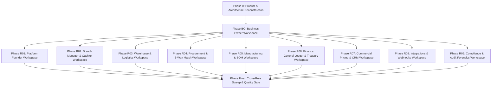

# STOKROVA Implementation Phase Tracker
## Phased Execution Roadmap, Role Dependencies & Certification Gates

**Project:** STOKROVA Enterprise Business Operations Platform  
**Authority:** Section 6 & 8 Master Mandate  
**Status:** Live Execution Phase Tracker

---

## 1. Phased Execution Roadmap

---

## 2. Phase Tracker & Milestone Status

| Phase ID | Phase Name | Focus & Role Coverage | Dependencies | Deliverables & Test Suites | Gate Status |
| :---: | :--- | :--- | :--- | :--- | :---: |
| **Phase 0** | **Product & Architecture Reconstruction** | Reconstruct all 12 platform domains, 32 personas, 26 pages, gap register. | Master Architecture, ADRs, Contracts | Feature Inventory, Role Access Matrix, Page Registry, Gap Register | **PASS** |
| **Phase BO** | **Business Owner Workspace** | Reconstruct complete Executive Command Center, 8 navigation sections, real API metrics. | Phase 0 | `ROLE_BUSINESS_OWNER_COMPLETION_REPORT.md`, `business-owner-workspace.spec.ts` | **PASS** |
| **Phase R01** | **Platform Founder Workspace** | Global multi-tenant onboarding, SaaS subscriptions, killswitches, system telemetry. | Phase BO | `ROLE_PLATFORM_FOUNDER_COMPLETION_REPORT.md`, `platform-founder-view.spec.ts` | **PASS** |
| **Phase R02** | **Branch Manager & Cashier Workspace** | Store management, POS checkout, till sessions, float & blind cash reconciliation. | Phase BO | `ROLE_BRANCH_MANAGER_COMPLETION_REPORT.md`, `ROLE_CASHIER_COMPLETION_REPORT.md` | **PASS** |
| **Phase R03** | **Warehouse & Logistics Workspace** | Pick waves, 8-tier bin routing, packing, SSCC-18 pallet labels, BOL, driver POD. | Phase BO | `ROLE_WAREHOUSE_PICKER_COMPLETION_REPORT.md`, `ROLE_LOGISTICS_MANAGER_COMPLETION_REPORT.md` | **PASS** |
| **Phase R04** | **Procurement & Supply Workspace** | Suppliers, purchase orders, goods receipt (GRN), landed costs, 3-way matching. | Phase BO | `ROLE_PROCUREMENT_OFFICER_COMPLETION_REPORT.md`, `procurement.spec.ts` | **PASS** |
| **Phase R05** | **Manufacturing & BOM Workspace** | Multi-level BOM formulas, production orders, shop floor execution, scrap approvals. | Phase BO | `ROLE_PRODUCTION_MANAGER_COMPLETION_REPORT.md`, `manufacturing.spec.ts` | **PASS** |
| **Phase R06** | **Finance, General Ledger & Treasury** | Double-entry journal entries, Chart of Accounts, period close, multi-company consolidation. | Phase BO | `ROLE_FINANCIAL_CONTROLLER_COMPLETION_REPORT.md`, `finance.spec.ts` | **PASS** |
| **Phase R07** | **Commercial Pricing & CRM Workspace** | Multi-tier price lists, margin floors, promotions, loyalty ledger, leads & opportunities. | Phase BO | `ROLE_PRICING_MANAGER_COMPLETION_REPORT.md`, `ROLE_CRM_ADMINISTRATOR_COMPLETION_REPORT.md` | **PASS** |
| **Phase R08** | **Integrations & IT Admin Workspace** | Connectors (Shopify, QuickBooks), webhook retry & replay, scoped rotatable API keys. | Phase BO | `ROLE_INTEGRATION_ADMIN_COMPLETION_REPORT.md`, `integration_hub.spec.ts` | **PASS** |
| **Phase R09** | **Audit Forensics & Compliance** | Append-only Merkle ledger, SOX 404 controls, sensitive data sanitization. | Phase BO | `ROLE_AUDITOR_COMPLETION_REPORT.md`, `audit.spec.ts` | **PASS** |
| **Final** | **Application-Wide Certification Sweep** | Cross-role verification sweep, zero demo features, full test passing, typechecks. | All Phases | `STOKROVA_FINAL_COMPLETION_REPORT.md`, 721 Monorepo Tests Passed | **PASS** |
