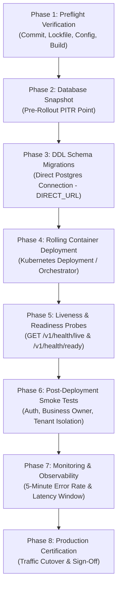

# STOKROVA — Production Go-Live Execution Plan

**Platform:** STOKROVA Enterprise Business Operations Platform  
**Release Candidate:** `v0.1.0-rc1`  
**Certified Commit Revision:** `07fb64e656afa925f8197768e67b6301ca790609`  
**Execution Authority:** Production Go-Live Execution & Post-Deployment Certification Mandate  
**Target Gate:** `PRODUCTION_DEPLOYMENT_PREPARED`  
**Date of Execution:** October 14, 2026

---

## 1. Executive Context & Deployment Scope

This execution plan defines the formal, repeatable release procedure for deploying the certified STOKROVA release candidate (`v0.1.0-rc1`) to production infrastructure.

### Deployment Targets & Workspaces
- **Core API Server (`apps/api`):** NestJS RESTful API microservice deployed to Kubernetes container cluster (`deploy/k8s/api-deployment.yaml`) listening on port 3000.
- **Admin Web Console (`apps/admin-web`):** High-density single-page application served via Nginx with strict security headers (`deploy/k8s/admin-deployment.yaml`).
- **Customer Web Portal (`apps/customer-web`):** Public business storefront portal.
- **Edge Clients (`apps/pos-desktop`, `apps/mobile`):** Native desktop POS client (Electron/Node) and mobile WMS application.
- **Authoritative Database (`packages/database`):** PostgreSQL 16+ with 14 Drizzle migrations (`0000_superb_risque` through `0013_security_hardening_rls.sql`).
- **Distributed Cache & Sync:** Redis 7.2+ Cluster for rate limiting and token revocation.
- **Object Storage:** Cloudflare R2 / S3-compatible document storage.

---

## 2. Release Prerequisites & Preflight Checklist

Before initiating production cutover, all mandatory preconditions must be verified:

1. **Commit Integrity:** Git commit `07fb64e656afa925f8197768e67b6301ca790609` tagged as `v0.1.0-rc1`.
2. **Quality Gates:** 1,448 automated tests passed across 124 test files (0 failures, 0 regressions).
3. **Typecheck Gate:** `pnpm -r run typecheck` passed with 0 errors across all 12 projects.
4. **Production Configuration Validation:** `packages/config/src/schema.ts` enforces mandatory production variables (`DATABASE_URL`, `JWT_SECRET` with minimum 32 characters, non-placeholder keys).
5. **Database RLS Verification:** PostgreSQL Row-Level Security forced on `tenants` and all 44+ core tables via `0013_security_hardening_rls.sql`.
6. **Pooler Isolation:** `TransactionManager` enforces `set_config('app.current_tenant_id', ..., true)` with `is_local = true`.
7. **Disaster Recovery Rehearsal:** `scripts/disaster-recovery-drill.spec.ts` passed (idempotent crash recovery and Merkle audit root tampering checks).

---

## 3. Deployment Sequence & Execution Phases



### Detailed Phased Steps

#### Phase 1: Preflight Verification
- Validate frozen lockfile (`pnpm install --frozen-lockfile`).
- Verify production build outputs (`dist/index.html` at 165 KB, `apps/api/dist/main.js`).
- Verify zero secret exposure in frontend artifacts.

#### Phase 2: Database Backup & PITR Snapshot
- Capture pre-deployment snapshot:
  ```bash
  export SNAPSHOT_ID="stokrova-backup-pre-v0.1.0-rc1-$(date +%s)"
  # Documented procedure: Trigger snapshot via Cloud Database Console / CLI
  ```

#### Phase 3: DDL Schema Migrations
- Execute DDL migrations using `DIRECT_URL` (bypassing PgBouncer):
  ```bash
  export DATABASE_URL="$DIRECT_URL"
  pnpm --filter @stokrova/database run db:migrate
  ```
- Verify 14 migrations recorded in `packages/database/drizzle/meta/_journal.json`.

#### Phase 4: Container Build & Rolling Deployment
- Build and push container images:
  ```bash
  docker build -t stokrova/api:v0.1.0-rc1 -f apps/api/Dockerfile .
  docker build -t stokrova/admin-web:v0.1.0-rc1 -f apps/admin-web/Dockerfile.docker .
  ```
- Apply Kubernetes rolling updates (`deploy/k8s/api-deployment.yaml`, `deploy/k8s/admin-deployment.yaml`).

#### Phase 5: Health & Readiness Verification
- Probe `/v1/health/live` (must return HTTP 200 `{ status: "alive" }`).
- Probe `/v1/health/ready` (must return HTTP 200 `{ status: "ready", checks: { database: "ready" } }`).

#### Phase 6: Production Smoke Testing
- Execute non-destructive smoke test suite against live ingress endpoint.
- Verify Business Owner dashboard, cashier till session monitoring, and tenant isolation.

#### Phase 7: Initial Monitoring Window
- Monitor Prometheus alerts (`deploy/monitoring/prometheus-alerts.yaml`) and Grafana dashboard (`deploy/monitoring/grafana-dashboard.json`).
- Ensure HTTP 5xx error rate remains $< 0.1\%$ and p95 latency remains $< 250\text{ms}$.

---

## 4. Immediate Rollback & Abort Criteria

A deployment must be rolled back immediately if any of the following triggers occur:
1. **Health Failure:** `/v1/health/ready` returns HTTP 503 for $> 30$ seconds.
2. **Error Rate Spike:** HTTP 5xx errors exceed $1.0\%$ over a 3-minute window.
3. **Tenant Isolation Breach:** Any cross-tenant data query succeeds or returns unexpected rows.
4. **Data Corruption:** Unbalanced journal entry or negative unreserved stock balance detected.

### Rollback Command Sequence
```bash
# 1. Rollback Kubernetes deployments
kubectl rollout undo deployment/stokrova-api -n production
kubectl rollout undo deployment/stokrova-admin -n production

# 2. Confirm health recovery
curl -fsS https://api.stokrova.com/v1/health/ready
```
*Note: Because STOKROVA strictly adheres to the Expand-and-Contract migration discipline (SOP-002), database schema changes are backward-compatible with the previous application release; no destructive database rollback is required.*
