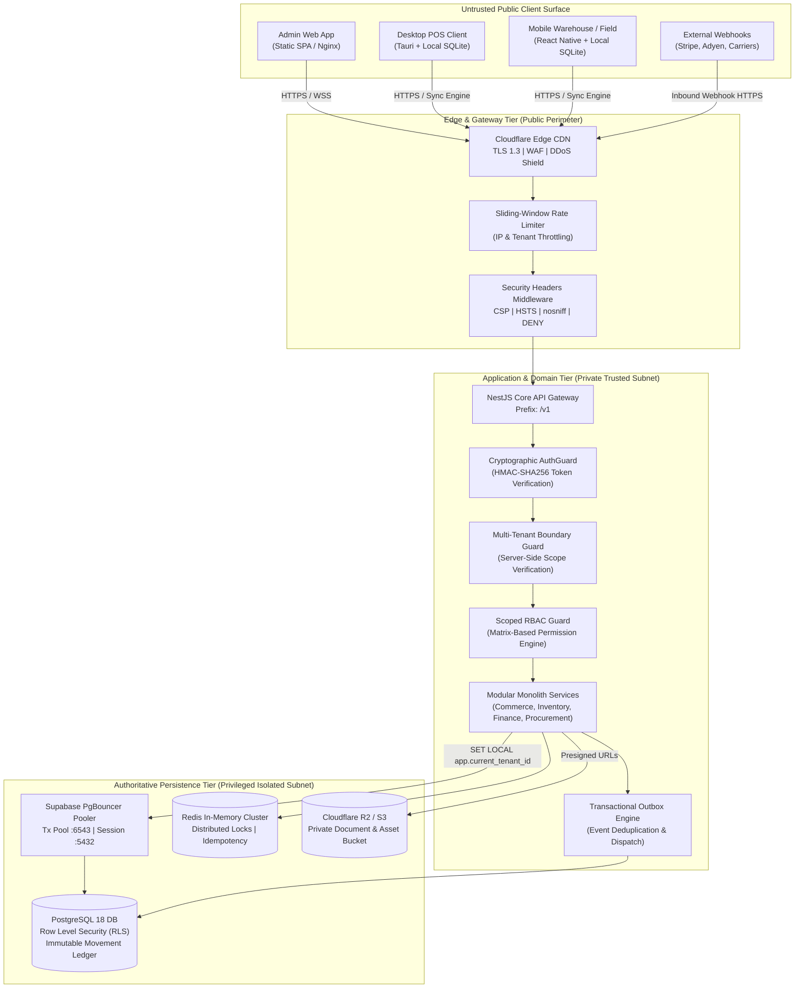

# STOKROVA — Production Architecture & Deployment Topology Blueprint

**Platform:** STOKROVA Enterprise Business Operations Platform  
**Target Gate:** `PRODUCTION_READY`  
**Classification:** Operational Architecture Reference (ADR-022)  
**Date:** October 13, 2026  

---

## 1. High-Level Architectural Model

STOKROVA is designed as an **Offline-First Modular Monolith** with decoupled multi-surface clients, transactional outbox event streaming, and strict multi-tenant cryptographic isolation.



---

## 2. Trust Zones & Security Perimeters

| Zone | Components | Access Rules & Invariants |
| :--- | :--- | :--- |
| **Zone 0: Public Untrusted** | Browser clients, POS workstations, Mobile handhelds, Public Internet | No server credentials or secret keys are ever delivered to or stored on client devices. All requests must present cryptographically signed Bearer tokens. |
| **Zone 1: DMZ / Edge** | Cloudflare CDN, Ingress Nginx, Rate Limiting, CORS filters | Terminate TLS 1.3; enforce strict CORS allowlist (`CORS_ALLOWED_ORIGINS`); block SSRF loopback (`127.0.0.1`, RFC 1918) and cloud metadata targets (`169.254.169.254`). |
| **Zone 2: Private Application** | NestJS Core API, Outbox Publisher, Background Workers | Runs in isolated virtual network (VPC/Container network). Non-root execution (`stokrova:1001`). Process liveness (`/v1/health/live`) and dependency readiness (`/v1/health/ready`) probes active. |
| **Zone 3: Privileged Data** | PostgreSQL (Supabase), Redis, Cloudflare R2 | Direct public access blocked. Database connections require SSL (`sslmode=require`). PostgreSQL Row-Level Security (`0013_security_hardening_rls.sql`) enforced on all tables. |

---

## 3. Database Connection Pooling & Tenant Context Isolation

STOKROVA leverages Supabase's managed connection pooler (PgBouncer) for high-concurrency connection multiplexing.

### The Connection Bleed Risk
In multi-tenant systems using connection poolers in transaction mode, stateful session settings (like `SET app.current_tenant_id = 'xxx'`) could leak to subsequent requests from different tenants sharing the same physical connection if not scoped.

### The STOKROVA Solution: `set_config(..., is_local=true)`
Every tenant-scoped transaction executed by `TransactionManager` runs:
```sql
SELECT set_config('app.current_tenant_id', $1, true),
       set_config('app.is_platform_admin', $2, true);
```
- Setting `is_local = true` (identical to `SET LOCAL`) strictly bounds the parameter to the immediate PostgreSQL transaction.
- When the transaction issues `COMMIT` or `ROLLBACK`, PostgreSQL automatically clears the session setting back to default.
- Even under intense concurrent connection pooling, zero tenant context can bleed across consecutive transactions.

---

## 4. Authoritative Domain Invariants Under Partial Outages

### 1. Inventory Truth Invariant
- **Stock is not a mutable counter**: Stock balances are mathematically defined as the sum of immutable ledger movements:
  $$\text{StockOnHand}(\text{Product}, \text{Location}) = \sum \text{MovementUnits}$$
- During disaster recovery, balances are verified against the movement ledger (`stock_ledger`), preventing silent inventory drift.

### 2. Financial Immutability Invariant
- Financial transactions write immutable double-entry journal entries.
- Every journal transaction satisfies:
  $$\sum \text{Debits} = \sum \text{Credits}$$
- Historical journal entries are never mutated or silently deleted. Reversals require balancing credit/debit adjustment entries.

### 3. Payment & Capture Idempotency Invariant
- External payment gateway calls enforce mandatory `idempotency-key` tracking.
- An ambiguous provider timeout does not trigger an unverified retry; internal state checks query provider reconciliation before repeating irreversible captures.

### 4. Offline Synchronization Invariant
- Edge POS and Mobile clients record transactions in local SQLite outboxes with monotonic vector clocks.
- When reconnected to the central API, sync batches are verified and deduplicated by operation ID, preserving causal order without duplicate side-effects.

---

## 5. Background Workers, Queues, and Scheduled Jobs

- **Transactional Outbox Engine**: Domain events are committed in the same database transaction as business mutations (`outbox_events` table).
- **Worker Leases**: Background job runners acquire advisory locks (`pg_try_advisory_xact_lock`) or Redis distributed mutexes, preventing split-brain duplicate execution when multiple API replicas run in parallel.
- **At-Least-Once Delivery with Idempotent Consumer**: All event handlers verify the event idempotency table before executing side-effects (emails, SMS, webhooks, analytics aggregation).
