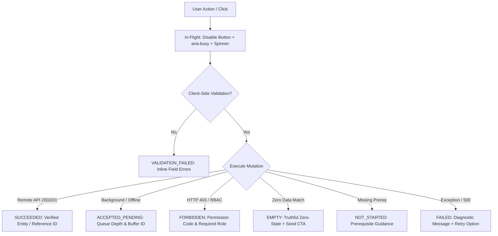

# STOKROVA — Page State, Feedback & Action Outcome Standard

**Standard Code:** `STD-QA-042`  
**Target Gate:** `REAL_ACTIONS_AND_FEEDBACK_VERIFIED`  
**Document Reference:** `docs/quality/STOKROVA_PAGE_STATE_AND_FEEDBACK_STANDARD.md`  
**Classification:** Enterprise UI/UX, Engineering Integrity & Security Standard  
**Date:** 2026-10-15  
**Version:** 1.0.0

---

## 1. Principles of Truthful Interaction

Every user interface in STOKROVA is bound by the **Truthful Interaction Mandate**:
1. **Zero Premature Success:** An action is never reported as successful before its authoritative execution and persistence has occurred.
2. **Deterministic States:** An interaction must cleanly resolve to one of seven discrete outcome states.
3. **Double-Submission Prevention:** All mutating action triggers must disable themselves and visually reflect an in-flight state until execution terminates.
4. **Transparent Offline Buffering:** If an action is saved to an offline queue or background worker, it must be reported as `ACCEPTED_PENDING` with the exact queue depth and local buffer ID—never falsely claimed as synced with the central cloud database.
5. **No Dead Clicks:** Every visible actionable control must either perform its designated action or provide an honest explanation of its prerequisites.

---

## 2. The Seven Canonical Outcome States

### 2.1. `SUCCEEDED`
- **Definition:** The business operation has executed to completion, domain invariants were enforced, and changes are permanently recorded in the database ledger or state container.
- **UI Presentation:**
  - Semantic Green badge/toast (`#14291F` background, `#4ADE80` text, `#1E4620` border in dark mode; `#F0FDF4` bg, `#16A34A` text, `#BBF7D0` border in light mode).
  - Explicit confirmation containing the newly created or mutated entity ID, invoice number, or journal reference (e.g. `✓ Journal JRNL-82910 posted. Ledger balanced ($0.00 delta).`).
- **Button Behavior:** Restored to default enabled state with normal label.

### 2.2. `ACCEPTED_PENDING`
- **Definition:** The operation has been safely buffered into a persistent local queue (e.g. POS offline ticket queue, driver drop record) or submitted to an asynchronous message broker (e.g. Kafka/RabbitMQ/Redis queue).
- **UI Presentation:**
  - Semantic Amber/Blue badge (`#1E222A` bg, `#60A5FA` text, `#1D4ED8` border).
  - Explicit declaration of pending state with queue index and sync telemetry (e.g. `⟳ Offline Buffered: Ticket #POS-882 queued locally (Buffer depth: 2). Will auto-sync when network reconnects.`).
- **Button Behavior:** Re-enabled with pending indicator if idempotent.

### 2.3. `VALIDATION_FAILED`
- **Definition:** Client-side validation or backend domain invariants rejected the submitted payload due to missing, malformed, or out-of-range data.
- **UI Presentation:**
  - Red border on offending inputs (`#EF4444`).
  - Contextual error message directly below the input field (e.g. `Account debit and credit lines must balance to exactly $0.00`).
  - No generic toast concealing the error; focus moves to the first invalid field.
- **Button Behavior:** Re-enabled immediately so the user can make corrections.

### 2.4. `FORBIDDEN`
- **Definition:** The authenticated user's assigned role codes or workspace scopes do not possess the required permission bit (e.g. a Cashier attempting to close an accounting fiscal period).
- **UI Presentation:**
  - Security warning dialog or banner with lock icon (`🔒`).
  - Precise citation of the required permission code (e.g. `Access Denied: Requires 'FINANCE_PERIOD_CLOSE' permission. Your current roles: ['CASHIER'].`).
- **Button Behavior:** Re-enabled or disabled with tooltip explaining the restriction.

### 2.5. `EMPTY`
- **Definition:** The requested table, view, or report has zero records matching the current filters or tenant scope.
- **UI Presentation:**
  - Centered honest zero-state illustration.
  - Informative explanation: "No records found in this branch."
  - Primary call-to-action button to create the first record (e.g. `+ Add First Supplier`).
- **Button Behavior:** Enabled.

### 2.6. `NOT_STARTED`
- **Definition:** A multi-step workflow or downstream feature cannot execute because required setup steps have not occurred (e.g. attempting to ring a sale before opening the cash drawer float).
- **UI Presentation:**
  - Neutral banner explaining the missing prerequisite.
  - Direct deep-link button to complete the required setup step (e.g. `Drawer is closed. Open till session to begin cashiering →`).
- **Button Behavior:** Disabled or converted to a navigation trigger.

### 2.7. `FAILED`
- **Definition:** An unexpected system exception, network partition, database connection timeout, or 500 error occurred during execution.
- **UI Presentation:**
  - High-visibility red alert toast or banner (`#EF4444` accent).
  - Diagnostic error summary (e.g. `Failed to post journal: Database lock timeout on ledger_accounts table.`).
  - Contextual "Retry Action" button.
- **Button Behavior:** Re-enabled with a "Retry" prompt.

---

## 3. In-Flight State & Concurrency Guidelines

1. **Button Debounce:**
   Every button click must be throttled or debounced. Instant double-clicks must be ignored.
2. **Visual In-Flight Feedback:**
   - Button attribute `disabled="true"` must be set immediately on click.
   - Button attribute `aria-busy="true"` must be set for screen-reader accessibility.
   - Text or icon should be replaced or augmented with a spinning glyph (`⟳` or SVG spinner) and descriptive text (e.g. `Posting to Ledger...`).
3. **Cleanup:**
   A `try ... finally` block must guarantee that button state is restored regardless of whether execution succeeds or errors out.
